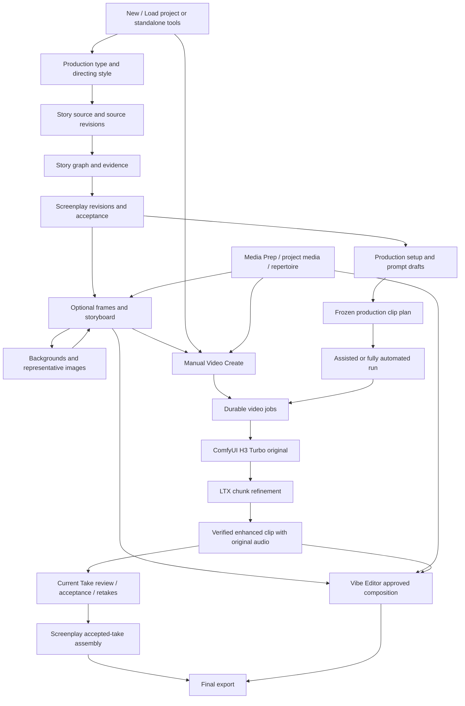
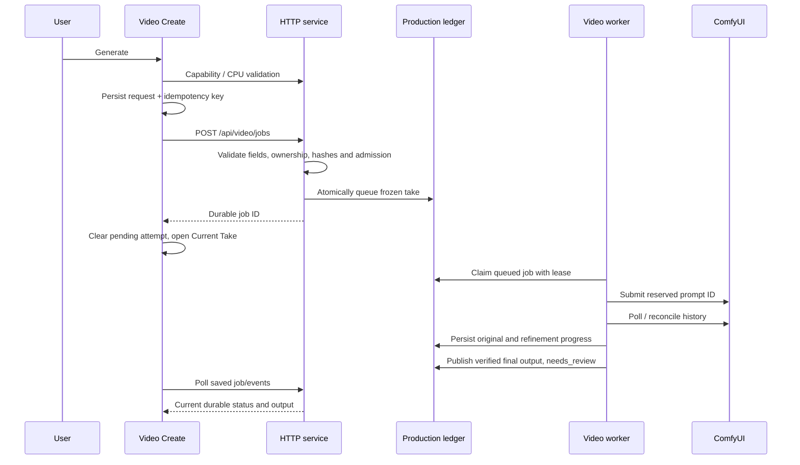

# Vibe Director: full video-production system review

Reviewed: 5 November 2026. Scope: the current local checkout, including its uncommitted source changes. This is a description and review of the implementation, not a claim that every installed model or workflow has passed a fresh generated-media test.

## 1. What you asked for, and what the app currently is

Your intended product is clear: open one project and recover its story, screenplay, media, settings and Director/Editor memory; use planning as advice; freely create or replace a clip; optionally let the Director automate selected stages; finish with enhanced clips assembled into a video. Output folders should be understandable and independent of creative decisions.

The current app contains much of that functionality, but it is distributed across several systems with different rules. It is not one continuous production engine behind a single interface.

The most consequential distinctions are:

1. **Manual Video Create** can work without a screenplay. Its final prompt and selected references are the generation inputs. Screenplay suggestions are advisory in this entry path in the current source.
2. **Screenplay production runs** use an accepted screenplay, saved settings, saved prompts and a frozen clip plan. These are strict inputs to an automated run. Changing them does not rewrite jobs already submitted.
3. **Storyboard preparation** has its own per-shot routes, optional stages, image preparation and manual/automatic choices. Its automatic frame preparation is not the same runner as Fully automated video production.
4. **Vibe Editor** is another project/session system. It turns selected media ranges and an approved editing plan into a HyperFrames composition.
5. **Screenplay assembly** is a separate accepted-take selection and FFmpeg export system. It does not automatically treat every loose project video as a screenplay shot.
6. **Project Save/Load** connects these systems through project identity, database snapshots, owned files and browser memory. The project folder is a portable checkpoint; parts of the live working state also reside in application storage.

This explains a large part of the confusion. A screen may say “ready” about the engine while another rule rejects the request; a file can be visible in the library without being a valid frozen reference; a finished manual clip can exist without belonging to a screenplay assembly slot.

**There is no contradiction in the workflow you requested. The implementation has overlapping models and incomplete integration between them.** Removing every safety check would lose duplicate prevention and recovery, but those checks do not need to control which creative route you choose.

### Evidence and limits

This review traces frontend components, API routing, services, contracts, persistence and worker logic. It distinguishes:

- **Implemented behavior:** directly visible in current source.
- **Confirmed design gap:** two current code paths demonstrably do different things, or a requested integration is absent from the traced path.
- **Risk requiring reproduction:** a plausible failure that has not been demonstrated during this review.
- **Historical symptom:** an error shown in the conversation; its meaning can be traced, but its original cause cannot be assigned to a particular earlier change without the corresponding request, logs and code revision.

No provider call, GPU generation, output migration or application-code edit was performed for this document. Static review does not establish visual quality, dialogue accuracy, installed-node compatibility or successful live recovery.

### Reading map

- [Architecture and terminology](#2-architecture-and-terminology)
- [Projects and storage](#3-projects-storage-and-what-load-project-restores)
- [Production type, story and screenplay](#4-production-type-and-style)
- [Optional assets and storyboard](#7-optional-assets-frame-per-shot-and-storyboard)
- [Automation and prompts](#8-automation-and-parameters-the-different-runners)
- [Media selection and search](#10-media-selection-discovery-and-semantic-search)
- [Generation contracts](#11-the-three-video-generation-modes)
- [Generate, recovery and locks](#12-what-happens-when-you-click-generate)
- [Turbo, LTX and stitching](#14-turbo-ltx-enhancement-and-within-clip-stitching)
- [Review, Editor and final assembly](#15-current-take-acceptance-retakes-and-next-clip)
- [Failures and review findings](#20-what-the-reported-errors-actually-mean)
- [API and source maps](#24-api-reference-for-the-production-paths)

## 2. Architecture and terminology



### Layers

| Layer | Responsibility | Main source |
|---|---|---|
| React/Vite frontend | Forms, selected project, draft prompts, reference ordering, chat, navigation and polling | [App.tsx](frontend/src/App.tsx), [StudioShell.tsx](frontend/src/StudioShell.tsx) |
| HTTP application | Dispatch, JSON validation, capability responses and service coordination | [isolated_server.py](backend/story_builder/isolated_server.py) |
| Planning/reasoning services | Story graph, screenplay, prompt proposals, clip planning, storyboard and editing plans | `backend/story_builder/services/` |
| Durable production ledger | Runs, takes, frozen inputs, state transitions, events and leases | [production_ledger.py](backend/story_builder/services/production_ledger.py) |
| Video worker | Claims jobs, stages references, submits/reconciles ComfyUI work, collects outputs | [production_job_worker.py](backend/story_builder/services/production_job_worker.py), [isolated_worker.py](backend/story_builder/isolated_worker.py) |
| Rendering engines | H3 generation, LTX enhancement, image workflows, HyperFrames and FFmpeg | Workflow JSONs plus their trusted adapters |
| Shared runtime controls | GPU admission, temperature/clock monitoring, process/provider guards | `gpu_runtime.py`, `gpu_watchdog.py`, `provider_exec_guard.py` |
| Storage services | Project checkpoints, media identities, safe locations and output publication | `projects.py`, `storage_paths.py`, `media_library.py`, `output_destinations.py` |

The normal launcher is `./start_vibe_director.sh`; README documents frontend port 8082 and backend port 3020. ComfyUI is a separate service, commonly configured at port 3008. Environment configuration may override service locations. Launching the HTTP application alone is not equivalent to launching all image/video workers.

### Words that currently refer to different things

| Term | Actual meaning |
|---|---|
| Project | User-facing folder/title and a persistent ownership identity |
| Workspace ID | Internal ownership key, commonly `story-…`; it still exists after removing workspace-selection UI |
| `tool-library` | Ownership context for standalone tool use, rather than a required user-created project |
| Source revision | A saved version of the story text |
| Graph snapshot | Extracted entities, facts/events and evidence for a particular source revision |
| Screenplay revision | Structured scenes/shots based on source, graph and style |
| Accepted screenplay | The revision approved as the basis of strict production planning |
| Shot | Creative unit in a screenplay; not necessarily one generated clip |
| Clip | A render-sized subdivision of a shot, with its own prompt and duration |
| Take/job | One durable generation attempt for a clip |
| Asset | An identified media file with ownership, location, hash, kind and metadata |
| Frozen request | Exact submitted generation inputs, preserved for provenance and recovery |
| Run | An orchestration record controlling a group of production clips |
| Editor project/session | An editing conversation, selected ranges, approved plans and renders inside the owning project |
| Assembly snapshot | Frozen ordered take choices and soundtrack instructions for final export |
| Output folder | Destination for published outputs; not the project identity or a replacement for the job database |

The application also has older `manual`/`semi`/`fully_automated` authority settings in [production_authority.py](backend/story_builder/services/production_authority.py), alongside newer `assisted_manual`/`fully_automated` setup modes. These are related concepts, not interchangeable schemas. The authority gates are `story_review`, `image_candidate_selection`, `voice_selection` and `shot_workflow_render_approval`.

## 3. Projects, storage and what Load project restores

Sources: [ProjectController.tsx](frontend/src/ProjectController.tsx), [projects.py](backend/story_builder/services/projects.py), [storage_paths.py](backend/story_builder/services/storage_paths.py), [project-state.ts](frontend/src/lib/project-state.ts).

### New project

The current UI separates New project and Load project.

1. Enter a project name and a parent save location, or choose a parent folder.
2. The backend validates the name and parent, derives a safe child-folder name and refuses to overwrite an existing child.
3. It creates a story/workspace identity, records the human folder mapping, saves an initial project checkpoint and activates the project.
4. The toolbar displays the resulting project title and its child folder.

The name is limited to 1–120 characters. With the normal parent, projects live beneath `local_data/projects/`. A project need not be placed beside source files; folder validation separates project content from protected source/runtime locations while supporting the application's established projects area.

### Load project

1. Choose the actual project folder containing `vibe-project.json`.
2. Read and validate its format, checkpoint reference and state hash.
3. Restore missing/appropriate project database rows and owned files, translating supported stored locations as needed.
4. Re-establish project/session registrations and appropriate folder grants.
5. Install the project's browser memory, active media owner and selected story identity.
6. Remount the project-dependent UI so pages fetch their own screenplay, runs, media and editing sessions.

Project selection must set both ownership and page state. Merely changing a folder label would not load a screenplay. `ProjectController` explicitly sets `vibe-media-active-workspace-v1` and `vibe-story-selected-v1` and maintains browser-state recovery copies when switching.

**Important merge rule:** loading a checkpoint is not always a destructive rollback. The backend preserves newer local working state when it determines that the application already has newer edits. Therefore “Load this folder” and “replace everything with this old snapshot” are not identical operations.

### Save project

Save is a consistency-checked checkpoint, rather than a single JSON containing every byte:

1. Require the relevant project to be idle.
2. Snapshot project-owned rows from production and image-job databases.
3. Collect project-owned files, tool sessions, relevant preferences and eligible browser memory.
4. Copy registered referenced media into checkpoint content where required, checking bytes against recorded hashes.
5. Recheck that database/files did not change during collection.
6. Write the checkpoint state and atomically publish `vibe-project.json` last.

The pointer contains fields including `format`, `version`, `workspace_id`, `title`, `checkpoint`, `state_path`, `content_path`, `runtime_path` and `state_sha256`. Its format identifier is `vibe-director-project`.

Conceptually:

```text
chosen-project-folder/
  vibe-project.json                 # authoritative checkpoint pointer
  project-data/…                    # versioned checkpoint state/content
  media/…                           # project media, where applicable
  editor/…                          # project-owned editing session documents
  music/…                           # project-owned music/ACE session documents
  …                                 # other project-owned working/output files
```

Exact checkpoint subpaths are recorded in the manifest; callers should follow those fields rather than inventing paths from this illustration.

### Live state is also stored outside the portable checkpoint

| Data | Live storage / authority |
|---|---|
| Story, graph, screenplay, setup, plans, production takes/events | Project-scoped rows in the configured production SQLite ledger |
| Image generation jobs and selections | Image-job database and asset/session records |
| Media catalogue | Shared library records with project ownership and safe location descriptors |
| Active project/folder registry | `local_data/library/projects/` and associated folder maps |
| Unsaved form state and draft selection | Browser `vibe-*` keys, also synchronized to project memory |
| Video intermediates | Project intermediates/originals/chunks |
| Editor and ACE sessions | Project-owned JSON, indexed by tool registries |
| Shared downloaded/repertoire media | Download and repertoire stores, reused by project references |
| Models, environments, provider credentials | Runtime/configuration stores; not portable project content |

The configured application ledger location is supplied through the application setup. `production_ledger.py` also has its own standalone default and environment overrides; inspecting only that constant would give an incomplete picture of the running app's database path.

Browser memory synchronization runs approximately every two seconds and attempts a `pagehide` sync. It is not a substitute for Save project. Eligible keys exclude sensitive/provider/debug/navigation categories and are size limited. A synchronization failure is surfaced rather than proving the disk checkpoint is current.

### External project files and shared repertoire

A media file placed externally into a project folder is eligible for recursive discovery even if an app workflow never registered it. Discovery then creates catalogue metadata while preserving the original file. Hidden folders, symlinks, checkpoint content and intermediates are excluded deliberately.

The video repertoire is a shared source/index store. A project may reference or copy an asset from it; this does not mean every project file is automatically duplicated into the repertoire or semantically indexed there. Portable Save can include the project's referenced media without converting the entire shared repertoire into project content.

### Output folder

[output_destinations.py](backend/story_builder/services/output_destinations.py) validates folder grants/preferences, freezes the selected destination into work, verifies copy/publication and resolves saved output locations.

- Project defaults and explicit output overrides coexist.
- Changing the current output preference does not redirect a job already admitted with a frozen destination.
- A moved project or a different machine may require a new grant for an external output folder.
- A project checkpoint and a published output are different artifacts; saving one does not imply every running render has completed.

Project save/open/select/new use locking and idle checks. This prevents mixing two projects' state mid-render, but can make “Load project” appear blocked by work in another page. The UI should identify the blocking job, not expose this only as generic busyness.

## 4. Production type and style

Sources: [ProductionStylesPage.tsx](frontend/src/ProductionStylesPage.tsx), [production_styles.py](backend/story_builder/services/production_styles.py), [prompt_styles.py](backend/story_builder/services/prompt_styles.py).

Production type describes the deliverable: for example a story/film, advertisement or presentation-oriented production. Directing style describes how it should be presented. These selections are versioned and can include analyzed reference material.

The app pins a style selection/snapshot into downstream screenplay/planning inputs. Style versions provide reproducibility: a generated plan should not silently change because a global style was later edited.

Production types do **not** each have an entirely separate video engine. The same T2V, reference-video, image and editing adapters are reused; style/type changes influence instructions and structured planning.

Changing type/style can make dependent planning stale. That is a dependency/version check; it should not prevent making a separate manual clip with your own final prompt.

## 5. Story preparation and source evidence

Sources: [StoryPage.tsx](frontend/src/StoryPage.tsx), [story_authoring.py](backend/story_builder/services/story_authoring.py), [story_imports.py](backend/story_builder/services/story_imports.py).

### User workflow

1. Open/create a project.
2. Type story text or import supported text content.
3. Save progress to create a source revision.
4. Prepare the story graph for that exact source revision.
5. Review extracted identities/facts and resolve ambiguities where needed.
6. Generate a screenplay from the saved source and graph.

The import UI supports text, Markdown and text-based PDF. Scanned PDF needs OCR before this text import path can use it properly. An import is staged/applied; it is not proof of complete story interpretation.

### Backend model

The story service maintains workspaces, source drafts, source revisions, chunk records, graph snapshots/chunks/records, evidence links, identity decisions, editing proposals and AI request records.

Graph preparation extracts canonical entities such as characters and locations, events/facts and evidence links. Identity decisions aim to prevent one character being accidentally duplicated under several names or unrelated people being merged.

Graph search is a lookup of extracted story knowledge. It is separate from semantic search over video/audio/image media.

### Editing behavior

Source edits and selected-field edits use version/expected-content checks. An AI replacement is a proposal; applying it creates a revision rather than mutating every historic output. A stale proposal must be reviewed again against current text.

This preserves history but creates downstream invalidation: a graph or screenplay based on source revision A is not automatically valid for source revision B.

## 6. Screenplay generation, editing and acceptance

Sources: [ScreenplayPage.tsx](frontend/src/ScreenplayPage.tsx), [ScreenplayDirector.tsx](frontend/src/ScreenplayDirector.tsx), [screenplay_schema.py](backend/story_builder/services/screenplay_schema.py), [story_authoring.py](backend/story_builder/services/story_authoring.py), [storyboard.py](backend/story_builder/services/storyboard.py).

### What a screenplay contains

Scenes carry a scene number, slugline, summary and shots. Shot data includes action, dialogue, camera, lighting, mood, sound effects, music, presentation classification, planned duration, character references and source-evidence references.

`presentation` distinguishes `image` from `video`. That classification describes the intended presentation; it does not itself generate an image, insert a timeline item or make the video model support arbitrary short durations.

### How generation works

1. Require a complete graph for the exact selected source revision.
2. Freeze source/style/graph/chunk identity into the task/request identity.
3. Generate bounded screenplay chunks sequentially through the selected reasoning provider.
4. Give the model source text, canonical cast, linked graph evidence, style and previous-chunk continuity context.
5. Parse a strict JSON schema and validate scene/shot structure and evidence ownership.
6. Persist completed chunks so they can be recovered without discarding all completed reasoning.
7. Combine results into a screenplay revision for review.

The provider execution timeout is **30 minutes** in `reasoning_provider.py` (`REASONING_TIMEOUT_SECONDS = 30 * 60`). That is a per-execution timeout, not a guarantee that a whole many-chunk screenplay finishes in 30 minutes. A provider can fail earlier for authentication, schema, process or model reasons.

Claims for in-progress chunks avoid duplicate reasoning. An expired claim can be marked uncertain rather than being blindly resubmitted; the task code accounts for the provider timeout plus a margin.

### What validation proves

Schema checks prove that expected fields and evidence links exist and refer to the allowed source chunk. They do not prove the writing is good, dialogue is correctly attributed, every source event was extracted, or the shot is visually executable.

For example, “74/74 extracted records linked” means all 74 extracted records were accounted for. It does **not** prove the graph extracted every important fact in the original story. The current UI contains wording acknowledging this distinction.

### Whole-screenplay conversation

The whole-screenplay Director supports discussion, change proposals and application as separate operations. A conversation is meant to establish intent; applying selected changes saves a new revision. Specific field-edit chats remain separate from whole-screenplay direction.

Useful instructions can concern all shots: speaker attribution, reducing still-image holds, splitting long dialogue or changing presentation classifications. They still need a reviewed structured change before downstream production uses them.

### Acceptance and staleness

Acceptance designates the revision used by strict production setup/prompt planning. It is not a creative prohibition on generating unrelated media. The current manual Video Create path tolerates absent/stale advisory screenplay lineage; automated planning remains stricter.

A new source/style/screenplay revision can invalidate saved setup or prompt plans. Old takes and frozen requests should remain available as historical artifacts rather than being rewritten to pretend they were produced from the new version.

## 7. Optional assets, Frame per shot and Storyboard

Sources: [ImageAssetsPage.tsx](frontend/src/ImageAssetsPage.tsx), [CharacterVoicesPage.tsx](frontend/src/CharacterVoicesPage.tsx), [StoryboardPage.tsx](frontend/src/StoryboardPage.tsx), [storyboard.py](backend/story_builder/services/storyboard.py), [production_image_admission.py](backend/story_builder/services/production_image_admission.py).

### Character images

Character masters are image assets connected to canonical character identities. Their purpose is consistent identity across shots. Uploads, generation and approved image selections are distinct actions; a character record is not itself an image.

Image workflow choices include Qwen Image, Z-Image Turbo and Qwen Image Edit where appropriate. An edit workflow uses actual selected reference images; writing a character name into a prompt does not supply that reference to the engine.

### Character voices

Voice bindings associate canonical characters with reusable voice/audio identities. Auto-match and explicit selection are supported through the voice-binding service. Timed speech/audio creation is separate from choosing a voice reference for R2V.

An audio reference can identify a speaker or provide sound guidance. It is not automatically equivalent to an exact final dialogue track placed on the assembly timeline.

### Worlds and shot-specific backgrounds

There are two relevant models:

- The older world/location asset path creates references associated with locations, potentially with multiple views.
- Storyboard preparation stores a background for an individual shot and can use previous/reference imagery while preparing a new background.

These are not one universal “background per shot” engine. A world reference helps establish the place; the shot frame composes that place and characters for the individual shot. Reusing a previous background can help continuity, but semantic continuity is not guaranteed by hash/reference validation.

### First and last frames

FFLF/FL2VA means first-frame/last-frame-conditioned video. It requires two actual image assets. The image-generation quality issue and video-engine readiness are separate concerns.

The storyboard service explicitly has `FFLF_AUTOMATION_ENABLED = False`. Its UI permits manual FFLF work while disabling automatic FFLF selection/preparation. This matches the request to pause automatic use until image preparation improves; it does not claim the installed video nodes are missing.

There is still a separate Production Setup workflow enum that includes FFLF for assisted video automation. The pause is therefore not expressed as one universal shared policy across all orchestrators. Treat this as a policy-consistency gap requiring an explicit decision/test across the separate paths.

### Frame per shot

Each shot-preparation record can hold:

- Presentation type and intended duration.
- Route: `image`, `t2v`, `r2v`, `fflf` or `existing`.
- Manual/Director control.
- Background and representative image asset IDs.
- Image references and image/video prompts.
- First/last frame IDs when relevant.
- Final media, notes and durable image-attempt/batch identifiers.

The saved board uses an expected-revision check to prevent a stale tab overwriting a newer board. Validation ties scene/shot keys to the screenplay and checks that selected assets belong to the permitted ownership context and have the required media kind.

### Automatic frame preparation

The current `autoFrames` loop runs in `StoryboardPage.tsx`:

1. Require saved, unchanged board settings and automatic shot-frame preparation.
2. Iterate shots in board order.
3. Skip manual shots and shots already carrying a representative image.
4. Reject an automatic FFLF route while that policy is paused.
5. Optionally generate the shot background first.
6. Generate the representative image, using references/edit workflow where appropriate.
7. Poll the durable image batch roughly every two seconds.
8. Adopt the result and persist cleared/completed attempt state before proceeding.

Pause stops the browser's orchestration; the current saved image job can continue. Closing the page can stop the loop even though its admitted backend job survives. Returning can resume using saved batch/request information. This is less durable than a complete backend-owned storyboard orchestration job.

“Fully automated” on the board changes selected stage/shot control defaults. It does **not** mean a complete mixed T2V/R2V movie is automatically rendered, edited and exported. The UI explicitly says video shots open in Video for the owner's Generate click.

### Finished storyboard deliverable

The board represents the requested layout: scene description and dialogue on the left, ordered shot images on the right. A four-shot scene remains one scene with four associated images.

Export creates a standalone HTML document with embedded image data. Browser printing can produce PDF; this path is not a native PDF renderer. Export requires the relevant shot images to exist.

### Handoffs

- **Open saved shot in Video:** validates the saved board/current accepted screenplay, manual takeover where needed, prompt, duration and route-specific references; creates a draft handoff, not a render job.
- **Open in Editor:** converts each chosen final image/video into an editor selection with the planned duration; requires usable final media for every included shot. A deterministic session identity avoids replacing an already edited session with a fresh empty one on repeated handoff.
- **Storyboard export:** produces the board itself, without requiring video generation.

An image can be displayed for two seconds in a storyboard/editor composition. The local video generation contract still has a five-second minimum. These are two different operations.

## 8. Automation and Parameters: the different runners

Sources: [ProductionSetupPage.tsx](frontend/src/ProductionSetupPage.tsx), [production_setup.py](backend/story_builder/services/production_setup.py), [fully_automated_clip_plan.py](backend/story_builder/services/fully_automated_clip_plan.py), [isolated_video_jobs.py](backend/story_builder/services/isolated_video_jobs.py).

### Production Setup

The saved configuration contains control mode and automatic/manual step flags for:

1. Character images.
2. Character voice.
3. World images.
4. Frame images.
5. Video.

It also records workflow/image settings, quality/aspect, duration policy and applicable style references. The service requires the current accepted screenplay for the strict production path.

Assisted manual allows selected stages to be automatic and others manual. Some manual operations explicitly call `require_manual_step`; for example, manually assigning a voice can be rejected when that stage is controlled by automation. This is a real stage-authority restriction that remains in the app, unlike advisory manual Video Create lineage.

### Critical distinction: current Fully automated run

The current Production Setup validator requires all five stage flags to be false for `fully_automated`, because this route is described in code as the **image-free route**. The current full-run clip planner chooses T2V.

That is materially different from the proposed future pipeline where the Director predominantly uses character/background/shot images and R2V, optionally mixing T2V and stills.

| Path | Planning inputs | What it automates | Current stopping point |
|---|---|---|---|
| Manual Video Create | Your final prompt/settings/references | One admitted generation job and its refinement | Reviewable final clip |
| Assisted production run | Accepted screenplay, setup, saved shot prompts, clip plan/reference maps | Selected production clips under saved workflow/setup | Settled/reviewable takes; assembly/export is separate |
| Current full production run | Accepted screenplay/setup/prompt inputs, frozen manifest | Image-free T2V clip production, extending scene plans as needed | All clips settled; not automatically an exported movie |
| Storyboard automatic frames | Saved board, auto-selected shots/stages/prompts | Backgrounds and representative images | Prepared storyboard images; video handoff still separate |
| Vibe Editor | Selected media ranges, brief and approved timeline | Rendering the approved composition | Previewable edited video, then export |

### Shot prompts versus clip prompts

A screenplay shot can contain more action/dialogue than one model call should render. The clip planner divides it into clips within saved duration limits.

The planner uses source word-unit boundaries and validates coverage/order: it rejects missing, overlapping or duplicated ranges. Clip IDs are deterministic from project/revision/scene/shot/clip position. Prompt output must remain below the engine's character limit.

This is useful provenance, but word coverage does not prove good pacing or coherent visual direction. Splitting a long shot is not equivalent to determining the best editorial cut.

### Assisted plan preparation

Preparation reads accepted screenplay, setup and saved shot prompts and freezes their hashes. It refuses unsafe replacement once the corresponding run has started or bound jobs exist. Existing reference mappings may need an explicit discard/reset before replanning.

After the reasoning call, the service rechecks inputs transactionally. This prevents saving a plan generated from old settings over newly edited settings.

### Full-run version behavior

The current version-3 full-run manifest begins with a scene plan and can extend with later scenes from frozen inputs. It does not simply re-read whatever mutable prompt text is visible at each advance.

Older version-1/version-2 run branches contain R2V continuity behavior, including a previous clip's continuity frame and pinned identity/style references. Their presence in the service does not mean new full runs use that same mixed-reference route.

This version distinction is important when investigating an old saved run: its behavior can legitimately differ from a newly created run without either one being corrupted.

### Advancing a run

The runner enforces clip order and dependency rules. Failed, cancelled, stale or recovery-required predecessors pause progress. For pure T2V it can queue the next Turbo original while previous clips wait for LTX refinement. Overall completion waits for final reviewable/accepted results; Turbo originals alone do not finish the run.

Pause, stop, retry and resume operate on durable run/job state. A stopped or uncertain external job cannot safely be treated as though it never existed. These execution controls should be presented separately from creative planning controls.

### Independent T2V batch-file route

[t2v_batches.py](backend/story_builder/services/t2v_batches.py) supplies another video-creation entry path, independent of screenplay preparation. It accepts a JSON prompt list/object or a supported text batch format. The input must be nonempty, below 1 MB and contain 1–100 prompts with unique case-insensitive IDs.

Each entry supplies `id`, `time`, `AR`, `prompt` and either legacy `Quality` or separate `Q1`/`Q2`. Q1 identifies Turbo source quality; Q2 identifies final quality. The service converts entries into version-2 T2V requests with four steps, seed 1 and no references, then runs the ordinary CPU contract validation.

The manifest tracks each admitted job and uses stable admission keys so a crash between creating a job and saving its binding does not create another render. It advances sequentially with one outstanding job; uncertain execution waits for recovery, invalid output pauses progression, and unavailable capability waits for readiness. Existing output-name conflicts require explicit `overwrite` or `new_take` choices.

Pause lets the current clip potentially finish while stopping progression. Stop requests cancellation of admitted active work; Resume cannot bypass a batch still stopping. This batch is not a storyboard-generated mixed-media movie and does not automatically create a final cross-clip assembly.

### Saved setup parameter validation

Automated image-stage settings must exist for each selected image step and cannot be supplied for unrelated unchecked steps. Character/world automatic stages accept their supported text-to-image workflows; frame stages additionally accept Qwen Image Edit.

- Image width/height: 256–2048, divisible by 8.
- Steps: 4–16 for Z-Image Turbo/Qwen Image Edit, 20–80 for Qwen Image.
- CFG: 0.1–2 for Z-Image Turbo, 0.1–8 for the other listed workflows.
- World views: exactly 2, 3, 4 or 8; default 4.
- Duration policy: fixed integer duration or Director-selected integer bounds, within 5–30 seconds at setup level.
- Automatic style-video references: at most two pinned asset/hash/intent records; assisted automatic video with style videos requires R2V.

The generic setup duration ceiling is broader than the 15-second FFLF/R2V contract. Downstream planning/admission must respect the selected engine's tighter limits. A setup being structurally saveable does not mean every possible combination produces a valid engine request.

## 9. Prompt Preparation, chat and learning

Sources: [PromptPreparationPage.tsx](frontend/src/PromptPreparationPage.tsx), [PromptDirector.tsx](frontend/src/PromptDirector.tsx), [prompt_drafts.py](backend/story_builder/services/prompt_drafts.py), [prompt_director.py](backend/story_builder/services/prompt_director.py), [workflow_knowledge.py](backend/story_builder/services/workflow_knowledge.py).

### The prompt layers

1. **Screenplay fields:** action, dialogue, camera, lighting, mood, sound and music intent.
2. **Shot prompt draft:** editable prompt associated with a screenplay shot/workflow.
3. **Character/world image briefs:** target-specific text connected to canonical character/location graph records.
4. **Production clip prompts:** per-clip render text derived from saved shot drafts and duration limits.
5. **Manual Video Create final prompt:** text supplied for the individual job, including a manually pasted prompt.
6. **Frozen job prompt:** the exact submitted text; later edits do not alter it.

Saving shot drafts does not automatically prepare per-clip prompts. Preparing prompts does not itself generate media. Accepting a screenplay does not mean every prompt is semantically correct.

### Prompt Director

It offers `chat`, `propose` and `learn` operations. Discussions and proposed changes are stored separately from approved prompt guidance. Reviewed prompt changes/rules are saved with an expected-version check.

Character/world prompt targets come from accepted-screenplay graph entities, not arbitrary filenames. If the graph lacks a canonical character/location, the corresponding target can be absent even though a file with a similar name is visible in the media browser.

### What “learn” means here

Approved rules are stored per project with scopes `all`, `video`, `character` and `world`. The service permits up to 30 rules, each up to 1,000 characters. Image briefs are keyed by screenplay revision and target identity.

Applicable callers read the approved guidance and include it in reasoning prompts. Current user instructions, source facts, actual references and mandatory workflow/schema constraints take precedence. A skill-export endpoint produces reusable Markdown text from the approved rules.

This is **instruction memory**, not model fine-tuning. Exporting a skill does not automatically install it globally for every LLM, and not every model call automatically reads every project lesson. Vibe Editor has its own confirmed style-rule mechanism and does not simply ingest all Director lessons.

The app explicitly reads runtime instruction sources such as `skills/vibe-director/SKILL.md`, video-prompting references and the editor-director skill. Arbitrary plans/audits in the repository are not automatically all included in every generation request.

### Manual prompt and Collate

In current Video Create, a manually supplied final R2V prompt can be used without requiring Collate. Reference tags still need to refer to the actual selected references. Collation is a prompt-building convenience, not permission to generate.

Images, videos and audio are numbered independently. Changing selected references/order or main instructions can invalidate/clear a previously collated prompt to avoid applying old reference numbering. That behavior can be surprising and should be visible before overwriting carefully pasted text.

## 10. Media selection, discovery and semantic search

Sources: [MediaSourcePicker.tsx](frontend/src/MediaSourcePicker.tsx), [MediaLibraryPage.tsx](frontend/src/MediaLibraryPage.tsx), [media_library.py](backend/story_builder/services/media_library.py), [media_discovery.py](backend/story_builder/services/media_discovery.py), [media_semantic_search.py](backend/story_builder/services/media_semantic_search.py).

### Source scope and media kind are independent filters

A picker first defines *where* it looks, then the allowed kind(s), then optional metadata/query filters. “Image” is a media-kind restriction, not a requirement that a file was generated as a character image.

Discovery recognizes supported suffixes and probes files; actual generation admission additionally validates bytes, MIME/kind and hash. Therefore not every extension that looks like an image is necessarily accepted by every downstream engine.

### Catalogue source scopes

These are backend source keys; UI wording can differ by picker:

| Source key | Current scope and selection logic |
|---|---|
| `all` | Known project roots plus tool/shared download/repertoire discovery, combined with catalogue records, subject to allowed kind and other filters |
| `projects` | Known project roots, excluding standalone tool ownership; not the entire filesystem |
| `current` | Current project's canonical and registered saved project locations, or current standalone ownership as applicable |
| `downloaded` | Download-store/YouTube-download categorized assets and discovered downloads |
| `repertoire` | Repertoire assets, also including extracted/analyzed assets categorized under that source family |
| `extracted` | Assets associated with analysis/style-frame extraction metadata |
| `imported` | Assets categorized as project uploads/imports; not every externally copied project file necessarily carries this label |
| `generated` | Generated/default-category catalogue assets; generation category is metadata-based |
| `style` | Assets explicitly carrying a style-reference role |
| `ace_generated` | Audio marked with standalone ACE-Step source metadata |

Owner filters can narrow broad project browsing. Character/world/frame selections can further filter roles/targets. Broad folder discovery is what allows unregistered external project media to appear; role-specific registers remain useful for intentional “characters only” or “worlds only” filters.

**All sources does not mean Downloads, every mounted disk and every arbitrary folder on the computer.** A Downloads file needs to be in a configured/discovered source or explicitly chosen/imported through a supported folder/file grant. This boundary avoids silently indexing the whole machine.

### Recursive discovery

The scanner recursively walks authorized project/shared locations and creates stable media records after probing and hashing. It avoids symlinks and hidden paths, and excludes `project-data`, `checkpoint-media` and `intermediates` so old checkpoints and processing chunks do not flood source choices.

It compares file state around hashing to avoid registering half-written files. Previously archived records are not blindly resurrected. A browse request can consequently add catalogue metadata even though it does not modify the source media bytes.

### Reuse, copy, archive and deletion

Reuse can reference an existing asset rather than duplicating its original. Copy mode is explicit. Ownership/location and source provenance matter when moving media between projects.

Removing an attachment is a draft operation; it should leave the original media intact. Archiving a catalogue item and permanently deleting a file are different operations. Engine intermediate cleanup must not remove original source media or final published outputs.

### Ordinary search versus semantic search

Catalogue text filtering searches saved filename/description/tags. It cannot understand an untagged clip merely because the clip is visible.

Semantic search can retrieve from:

- Analyzed Video Summariser records: scene clips/video summaries, extracted frames and audio-event records.
- Saved annotation embeddings: filename/description/tags/roles embedded as text.
- Actual image/video/audio content embeddings stored against the current source hash.

The service checks real PE-AV/CLAP index metadata and vector dimensions rather than presenting an unavailable/deterministic fallback as genuine semantic evidence. Annotation indexing and content indexing are explicitly different operations.

Analysis/indexes must exist and match the asset bytes. Adding an untagged movie to a project does not automatically perform full transcription, scene analysis and embedding. Media Prep/Video Summariser and content-index jobs supply those capabilities; retrieval then returns candidates for a human/Director to choose.

Thus the existing semantic infrastructure is relevant to the desired OpenMontage-like repertoire retrieval, but it is not evidence that the storyboard automatically searches all source videos and builds a finished film today.

## 11. The three video-generation modes

Sources: [video-api.ts](frontend/src/lib/video-api.ts), [isolated_video_contract.py](backend/story_builder/services/isolated_video_contract.py), [isolated_fl2va_contract.py](backend/story_builder/services/isolated_fl2va_contract.py), [isolated_r2v_contract.py](backend/story_builder/services/isolated_r2v_contract.py), [minimax_h3_graph_compiler.py](backend/story_builder/services/minimax_h3_graph_compiler.py).

### Common contract principles

- Inputs use registered asset IDs and frozen SHA-256 hashes, not arbitrary filesystem paths passed to ComfyUI by the browser.
- Prompt text must be nonempty and strictly below 7,000 Unicode code points.
- Workflow ID, workflow version and workflow digest identify the exact supported graph contract.
- Version 2 uses the pinned Turbo plus LTX pipeline. Version-1 compatibility code exists for historical requests; that does not make arbitrary legacy requests valid new submissions.
- Exact JSON fields matter. An extra UI-only field can be rejected just as a missing required field can.
- CPU preview/validation is separate from worker readiness and actual generated-output validation.

### T2V: Text to video

Workflow ID: `minimax_h3_t2v_local_v1`.

Duration: 5–30 seconds. Inputs include workflow identity/digest, prompt, duration, aspect, resolution preset, steps, seed and `references` (empty for this path). An optional source-resolution preset is supported by its contract. New Turbo requests use four steps and seed 1. R2V has a different seed contract: an unsigned 32-bit integer, with the UI currently supplying its default.

It does not use selected character/world images just because they exist in the project. To condition generation on images, use a route that actually includes them.

### FFLF / FL2VA: First + last frame

Workflow ID: `minimax_h3_fl2va_first_last_v1`.

Duration: 5–15 seconds. Inputs include the common workflow/prompt/output settings plus `first_frame` and `last_frame`, each exactly an asset ID/hash pair.

Its public request schema is **not** the T2V/R2V schema: `steps`, `seed` and `references` are not generic fields to add to this endpoint. The graph/compiler owns its fixed execution details.

Both frame slots must be supplied. The app stages those exact images for the engine. Whether those images make a convincing transition remains a creative/model-quality question.

### R2V: Reference to video

Workflow ID: `minimax_h3_r2v_dynamic_v1`.

Duration: 5–15 seconds. Its top-level fields are:

```text
workflow_id, workflow_version, workflow_sha256, prompt,
duration_seconds, aspect_ratio, resolution_preset, steps, seed,
ref_image_size, images, videos, audios
```

Reference limits are up to nine images, three videos and three audio inputs, with further compiler/byte/content validation. Each reference includes `asset_id`, `sha256`, `role` and `intent`.

Video references additionally carry paired start/end interval fields, an explicit paired-soundtrack choice and audio intent. Audio references carry a supported single/shared speaker binding. The compiler resolves these into actual graph inputs rather than relying on prompt text alone.

This exact-field contract explains why “R2V request fields are missing or unsupported” is a request-shape failure. It does not mean the three visible selected files do not exist.

### Quality and aspect

[video-quality.ts](frontend/src/lib/video-quality.ts) defines several historical and current preset keys. Some old keys have unintuitive names: for example legacy `standard` is presented as Low at 864×480, while T2V `t2v_standard` is 1344×768. T2V presets also include 1664×928 and 1920×1088.

Do not infer dimensions from the word “standard” alone. Inspect the actual selected numeric preset and workflow. Portrait swaps dimensions; other aspect ratios preserve approximate pixel area and round to the model's 32-pixel grid.

The final quality target differs from the smaller Turbo source canvas. Upscaling/refinement belongs to the subsequent LTX stage, not a second unrelated user clip.

## 12. What happens when you click Generate

Sources: [App.tsx](frontend/src/App.tsx), [isolated_server.py](backend/story_builder/isolated_server.py), [isolated_video_jobs.py](backend/story_builder/services/isolated_video_jobs.py).

### Before submission

The frontend holds an editable draft: workflow, final prompt, references, duration/aspect/quality, clip identity, optional screenplay lineage, retake metadata and any pending-attempt record.

It validates prompt/duration and route-specific reference requirements. It checks capability/runtime state and whether an unresolved attempt or active conflicting batch already exists.

### Submission sequence



The request envelope contains `workspace_id`, `clip_id`, `idempotency_key`, `request`, and optional retake/provenance fields. The nested `request` must match the chosen workflow's exact schema.

### Why an idempotency key exists

Suppose Generate reaches the backend and creates a GPU job, but the reply is lost. If the browser immediately submits a new request, it could start two expensive renders. The saved key lets it ask whether the original job exists and recover it.

The same key must identify the same frozen request. Editing a prompt while pretending it is the same admitted attempt would make recovery ambiguous.

This restriction belongs to a **submitted/uncertain attempt**, not to a screenplay recommendation. A new creative draft should be possible once the old attempt is conclusively recovered or released.

### Definitive rejection versus uncertain outcome

- If admission definitively failed before job creation, the API can return `admission_state: not_created`. The UI can clear the attempt while preserving editable prompt/references/settings.
- If a network/server failure leaves the outcome uncertain, the UI retains the saved request/key and offers recovery rather than assuming no job exists.
- `GET /api/video/jobs/by-idempotency/{key}` looks up the attempt under its owner.
- `POST /api/video/attempts/release` atomically checks for an existing job; otherwise it records a release fence so a delayed submission with the old key cannot appear after editing is unlocked.

The release fence is important: simply deleting a browser key would make a delayed network request capable of creating an unexpected render later.

### Manual screenplay lineage in the current source

Manual submission is explicitly marked internally by the server. The service treats malformed/stale advisory screenplay lineage as absent rather than refusing otherwise valid manual generation. Valid lineage can still be retained for provenance/assembly association.

Automation uses stricter source/setup/prompt/plan checks. Retakes inherit relevant frozen ownership/provenance from their original take. These behaviors must not be conflated.

This is why the earlier `source_lineage` error was an inappropriate creative dependency for the manual action described in the conversation. The latest source contains a separate manual admission path intended to remove that restriction.

## 13. Durable jobs, workers and runtime admission

Sources: [production_ledger.py](backend/story_builder/services/production_ledger.py), [production_job_worker.py](backend/story_builder/services/production_job_worker.py), [production_t2v_capability.py](backend/story_builder/services/production_t2v_capability.py), [production_r2v_capability.py](backend/story_builder/services/production_r2v_capability.py), [production_fl2va_capability.py](backend/story_builder/services/production_fl2va_capability.py).

### Main job states

```text
draft → validated → queued → submitting → running → collecting
                                           ↑             |
                                           |             v
                                    refinement_pending → queued
                                                         |
                            verified final collection → needs_review → accepted
```

This is a simplified happy path. The ledger also supports `waiting_for_predecessor`, `waiting_for_user`, `retrying`, `failed`, `cancel_requested`, `cancelled`, `stale` and `recovery_required`, with explicit allowed transitions. `accepted` is terminal for that take; a retake is another attempt rather than an in-place rewrite.

### Persistence and concurrency

SQLite records runs, takes, events, frozen input snapshots, graph prompt IDs, attempts, worker leases, heartbeats, output hashes and errors. Transactions and uniqueness constraints prevent duplicate ownership/key/take admissions.

The worker has leases and heartbeats so a second process does not casually claim work still owned by a live worker. It persists external prompt identity before submission, stages verified inputs and records stage progress.

The worker's render timeout is separate from the LLM timeout. Its long-running render limit is measured in hours; it also uses much shorter submission/network calls and regular heartbeats.

### External submission and restart

ComfyUI work is external to the SQLite transaction. A network error after submission cannot prove the engine did nothing. The worker reconciles queue/history using the reserved prompt ID before deciding whether to continue, collect or require recovery.

Definite engine rejection can become failure. Unknown execution outcome becomes `recovery_required`; automatically resubmitting could create duplicate GPU work. Cancellation targets owned work and must account for an output arriving while cancellation is being processed.

### Capability is several different facts

| Fact | Meaning | Does not prove |
|---|---|---|
| Workflow graph/contract available | Expected graph files/digests and schema are present | Installed custom nodes can execute them |
| Required nodes/inputs available | ComfyUI object-info matches needed interfaces | Your draft has valid references/prompt |
| Worker/runtime ready | Dispatch infrastructure is available | Current GPU admission or output quality |
| Manual workflow available | A manual trial can be admitted | Automation acceptance evidence exists |
| `render_verified` | A matching successful video/audio acceptance record exists | Every possible future request succeeds |
| `automation_available` | Capability plus required acceptance evidence permits automation | A whole film is approved or complete |

The R2V message “Ready for your first R2V test” means manual testing can be allowed while automatic use waits for a matching successful video-with-audio record. Those two states should not be presented as contradictory.

### GPU safeguards

Shared admission/watchdog coordinates generation/analysis workloads and monitors temperature and clock conditions. The configured limits are 90°C and 2100 MHz. Monitoring failures, holds or conflicting workloads can prevent admission or require recovery.

These safeguards are execution constraints, not screenplay approval. Removing them to unlock a creative form would conflate two unrelated concerns.

## 14. Turbo, LTX enhancement and within-clip stitching

Sources: [minimax_h3_t2v.py](backend/story_builder/services/minimax_h3_t2v.py), [t2v_pipeline.py](backend/story_builder/services/t2v_pipeline.py), [ltx_chunks.py](backend/story_builder/services/ltx_chunks.py).

### What the pipeline is supposed to deliver

The final user clip is the **LTX-enhanced, stitched result with the original generated audio**. The Turbo original and temporary LTX chunks are processing artifacts, not substitute accepted outputs.

### Stage A: H3 Turbo original

The compiler builds the appropriate T2V, FFLF or R2V graph from the frozen request. H3 runs at a smaller source canvas and model-compatible frame count. Frame alignment may require extra generated frames beyond the exact requested duration.

For the T2V compiler, frames are aligned to its H3 rule after computing the requested 24-fps count. Final output is later trimmed to the requested count; the aligned source tail is not an instruction to make the user clip longer.

The original file is copied/verified into project intermediates and its identity/hash is preserved for refinement and audio recovery.

### Stage B: durable refinement plan

The pipeline verifies the combined pinned H3/LTX digest and original bytes. It probes video/audio, detects hard scene cuts and plans bounded LTX windows.

The chunking logic uses a nominal 65-frame window with 16-frame overlap and model-compatible padding (`8k+1`, minimum 17). Hard-cut boundaries are treated separately so overlap blending does not smear across an actual cut.

Each chunk gets its own staged input path. Reusing one path for different chunk contents could allow external caching to return the wrong frames; distinct paths prevent that identity ambiguity.

### Stage C: enhance each chunk

For each window, the trusted adapter sets the LTX input, final canvas, prompt and output prefix. It adds preservation guidance rather than asking the model to invent a new scene.

On collection it requires the expected final width/height and enough frames for the padded window. Each validated chunk is hash-checked and checkpointed. This allows later chunks/recovery to use already verified work.

### Stage D: join, trim and restore audio

1. Verify chunk identities, hashes and order.
2. Decode/join frames at the final canvas.
3. Blend planned overlaps within continuous scenes.
4. Avoid overlap blending across detected hard cuts.
5. Remove model padding and verify the assembled frame count.
6. Remux the original H3 audio with the enhanced video.
7. Trim to the exact requested 24-fps frame count.
8. Probe dimensions, frames, duration and required audio/video streams.
9. Publish only the verified final output and transition toward review.

### Two separate meanings of “stitch”

- **Within one generated clip:** stitch its LTX refinement chunks back together. This is required before the clip is complete.
- **Across a movie:** assemble several finished clips/images with soundtrack and editorial choices. That happens through screenplay assembly or Vibe Editor.

An LTX chunk error is therefore not solved by publishing the low-quality original or by treating the first enhanced chunk as the finished clip.

## 15. Current Take, acceptance, retakes and next clip

Sources: [App.tsx](frontend/src/App.tsx), [isolated_video_jobs.py](backend/story_builder/services/isolated_video_jobs.py), [production_job_worker.py](backend/story_builder/services/production_job_worker.py).

Current Take polls the saved job and displays durable progress, errors, frozen request information and published outputs. Reloading the page should recover that job rather than start a new render.

### Review

A final collected clip becomes `needs_review`. The user can inspect it and accept it. Automated Director review, where used, has its own evidence/decision handling; byte-level output validation does not replace semantic review.

### Acceptance

Accept records approval of that take. It does not alter its prompt, source references or media bytes. It can make the take eligible for screenplay assembly if it has the appropriate clip association.

Accepting one clip should not prevent creating an unrelated manual clip. Recommendation navigation and submitted-attempt recovery are separate state transitions.

### Retake

The public retake endpoint prepares a draft from an existing take with the keep-original choice. It does not immediately submit a new GPU job. The owner can edit the draft and click Generate to create the next take.

The original remains available according to the chosen retention/review behavior; retakes maintain parentage rather than overwriting history.

### Next clip and unlinked media

Next can load the next recommended planned clip, or create a fresh standalone draft when no recommendation is applicable. A manually generated unlinked clip is still valid project media, but it is not automatically evidence that screenplay scene X/shot Y has been fulfilled.

It can be assembled through explicit media selection in Vibe Editor. To use it in strict screenplay assembly, the system needs a valid association/selection; merely matching its filename or prompt is not sufficient.

## 16. Vibe Editor / HyperFrames

Sources: [VibeEditorPage.tsx](frontend/src/VibeEditorPage.tsx), [EditorWorkspace.tsx](frontend/src/EditorWorkspace.tsx), [vibe_editor.py](backend/story_builder/services/vibe_editor.py), [vibe_editor_api.py](backend/story_builder/services/vibe_editor_api.py), [vibe_editor_render.py](backend/story_builder/services/vibe_editor_render.py), [editor_effects.py](backend/story_builder/services/editor_effects.py).

### User workflow

1. Open/create an editor session under the current project or standalone owner.
2. Select/import source image/video/audio assets and exact ranges.
3. Discuss the intended edit in chat.
4. Review the proposed creative brief and answer essential questions.
5. Approve the brief.
6. Prepare/review a concrete media-and-tool plan.
7. Approve that exact timeline to render.
8. Review the rendered preview and export to the chosen folder/name.

The two approvals are real editor behavior: brief approval and executable-plan approval. A chat message that is not an explicit assent revises/discusses the brief instead of silently approving rendering.

### Current executable capability

The adapter supports sequential video/image clips, image holds, contain/cover fitting, static captions, effects, speed ramps and overlapping transitions. Current transitions include cuts, dissolve and several shader/warp transitions. A warp/blend transition is not an AI transformation of a subject.

Validated composition limits include:

- 1–100 visual clips.
- Even width/height between 128 and 3840.
- Frame rate 24, 25, 30 or 60.
- A total validated clip-duration budget of ten minutes.
- Optional **one replacement audio range**, not an unrestricted multitrack audio workstation.
- Supported speed range 0.25×–4× with validated transition overlap lengths.

When a replacement soundtrack is supplied, source video audio is muted in this renderer. This differs from screenplay assembly's preserve-and-mix audio policy.

### What the LLM actually does

It returns a structured brief or JSON plan using selected asset IDs/ranges. It does not generate arbitrary executable HTML or shell code. Unsupported specialist requests are supposed to return an explicit blocker instead of pretending a missing Blender/generation adapter exists.

The service rejects plans that introduce unselected assets or exceed approved ranges. Plans and style snapshots are versioned, and stale responses do not apply to a newer editing revision.

### HyperFrames rendering

Trusted Python code converts the validated plan into local HTML/GSAP/HyperFrames inputs. It stages approved media, preprocesses selected effects/speed changes with FFmpeg, and uses a network-isolated browser sandbox.

Runtime capability checks include HyperFrames, shader transitions, Node, browser, bubblewrap and FFmpeg. The configured browser path/version and runtime installation are operational dependencies; source correctness does not prove they are installed.

The renderer has a two-hour execution limit, saves detailed render logs and validates publication. Export requires a completed output, an existing absolute folder and a plain `.mp4` filename. Pause prevents export until resumed. Collision/overwrite handling is distinct from rendering a new composition.

### Editor memory

Style rules are proposed separately, remain unconfirmed until explicitly confirmed and are scoped to the selected style/project override. Only confirmed rules enter the relevant reasoning context. Approving an edit brief does not automatically confirm a newly proposed permanent preference.

### Integration limit

HyperFrames is the rendering/editing adapter, not a substitute for project orchestration or semantic media retrieval. It can consume storyboard/media selections, but it does not by itself decide all screenplay routes, generate every missing asset, align all dialogue and music, or manage the full production run.

## 17. Screenplay assembly and final movie export

Sources: [AssemblyPreviewPanel.tsx](frontend/src/AssemblyPreviewPanel.tsx), [assembly.py](backend/story_builder/services/assembly.py), [assembly_renderer.py](backend/story_builder/services/assembly_renderer.py), assembly job services and HTTP routes.

### Sequence

1. Build a screenplay-ordered preview from its clip plan and eligible accepted takes.
2. Select one accepted take for each planned clip.
3. Optionally place soundtrack assets with explicit start, trim and gain.
4. Freeze an assembly snapshot after the plan is complete.
5. Choose export settings.
6. Create an export manifest and durable export job.
7. Verify source assets, normalize/concatenate/mix with FFmpeg and publish a validated final file.

The snapshot requires a complete plan and one accepted take per clip. It freezes requests/provenance, output hashes and audio instructions. This is an intentional strict export contract; the current UI does not turn it into a freeform editor merely by renaming shots “recommendations.”

### Audio and output limits

Assembly supports up to 20 optional audio assets, with verified hash/duration, explicit placement/trims and gain 0–2. The same asset ID can only appear once in that track list. That prevents some repeated-SFX patterns unless an appropriate alternate representation is provided.

Supported export settings are MP4/H.264/AAC, 720p/1080p/1440p, 24/30/60 fps and CRF 18–28. Audio policies are:

- `preserve_and_mix`: retain clip audio and mix chosen tracks.
- `selected_tracks_only`: use selected tracks rather than clip audio.
- `mute`: silent export.

Export jobs use queued/rendering/completed/failed states and explicit retry for failures. A recovered CPU export is different from uncertain external GPU submission; their retry rules need not be identical.

### Relationship to Editor

Screenplay assembly and Editor are parallel finishing routes. Assembly favors exact screenplay coverage and provenance. Editor favors explicit selected media/ranges and a custom approved composition. They have different audio limits, settings and persistence.

A universal final timeline containing both generated video and image holds is not currently the same object as the strict accepted-video-take assembly snapshot.

## 18. Audio, music, SFX and other optional tool branches

Sources: audio services in `backend/story_builder/services/`, [MusicSoundPage.tsx](frontend/src/MusicSoundPage.tsx), [AceStudioPage.tsx](frontend/src/AceStudioPage.tsx), Media Prep and the HTTP dispatcher.

Audio-related tools include voice import/reconstruction, timed TTS, audio utilities, sound effects, scene surgery, stitching, music jobs and control/foley operations. ACE-Step provides a separate music creation/session workflow. The resulting audio can enter the shared media library and be selected as references, editor soundtrack or assembly tracks as supported by each consumer.

These are different uses:

| Use | Result |
|---|---|
| Voice binding/reference | Guidance about speaker identity |
| R2V audio reference | Sound/speaker guidance included in a generation graph |
| Timed TTS/reconstruction | A generated or reconstructed audio asset |
| Music/SFX generation | A music/effects asset |
| Editor soundtrack | One selected replacement audio range in the current adapter |
| Assembly audio tracks | Explicitly positioned/mixed final audio assets |

A screenplay's music/SFX text is creative intent. It does not prove the corresponding audio file was generated, selected and mixed into the final film.

Text-to-image and 3D tools such as TRELLIS/Pixal3D are optional asset-production branches, not required stages of every video. Their standalone job APIs/runtime dependencies do not imply an automatic bridge from a 3D result into the current HyperFrames composition. A supported adapter/exported media handoff is still needed.

## 19. Every important kind of lock or restriction

“Locked” currently describes several unrelated conditions. The owner needs to see the cause, affected item and recovery action for each one.

| Restriction | Trigger / authority | Purpose | Creative implications |
|---|---|---|---|
| Temporary UI busy state | Request/upload/reasoning/preparation in progress | Avoid overlapping form mutations | Should be temporary and clearly animated |
| Capability loading | Frontend waiting for capability response | Avoid submitting with unknown contract/runtime state | Can temporarily disable workflow cards even when their nodes are fine |
| Pending attempt | Browser saved key/request, outcome unresolved | Prevent duplicate render | Must offer lookup/release; should not require screenplay editing |
| Frozen admitted request | Backend has queued/submitted job | Reproducibility and safe recovery | Editing requires a new draft/take, not mutating the old job |
| Existing unresolved job | Active job/attempt for current flow | Avoid conflicting submissions | Needs explicit job identity and navigation/recovery |
| Batch activity | Conflicting active batch, particularly T2V | Preserve orchestration order | Separate from basic engine capability |
| Screenplay acceptance | Strict setup/prompt/production consumer | Select production baseline | Should not gate unrelated manual clips |
| Source/setup/prompt hash | Automated lineage no longer matches | Avoid mislabeling output provenance | Replan/new run; do not silently relabel old work |
| Started-run plan freeze | Bound jobs/run already exist | Keep run deterministic | New creative plan should branch rather than destroy old run |
| Stage authority | Automatic/manual flags | Avoid two controllers selecting the same stage | Still a user-facing policy restriction needing clear takeover |
| FFLF automatic pause | Storyboard policy | Pause automatic frame route while quality improves | Manual FFLF remains a distinct choice |
| Automation smoke gate | No matching successful verified media evidence | Avoid untested unattended workflow | Manual test can still be available |
| Media hash/ownership | File changed/missing/wrong owner or kind | Use the intended source bytes safely | Re-select/re-register; not a screenplay-quality judgment |
| Workflow graph digest | Installed graph differs from pinned contract | Prevent wrong node bindings/settings | Needs coherent graph/contract update, not arbitrary bypass |
| Node-input readiness | Installed ComfyUI class schema incompatible | Ensure compiled inputs exist | Reference counts cannot fix it |
| GPU admission/safety hold | Workload/temperature/clock/monitor condition | Protect shared execution | Must not be removed to unlock planning UI |
| Worker lease | Another worker owns execution | Prevent duplicate dispatch | Recover/reconcile instead of taking over blindly |
| Stale revision/CAS | Another tab/process changed saved data | Prevent lost edits | Preserve local proposal; reload/merge/reapply |
| Editor approvals | Brief then plan not yet approved | Execute explicit selected edit | Current real product design, not screenplay enforcement |
| Complete assembly coverage | Missing accepted take for planned clip | Export exact screenplay assembly | Freeform alternative is Editor, not this strict snapshot |
| Project idle check | Active project work during checkpoint/switch | Keep checkpoint ownership consistent | UI should expose the blocking job |
| Output grant/collision | Destination unavailable or existing file differs | Prevent unsafe publication/overwrite | Resolve destination without changing creative plan |

### Exact Video Create form behavior

In the reviewed `App.tsx`, `formLocked` includes:

```text
busy
OR uploading references
OR uploading a first/last frame
OR a pending attempt
OR capability state is loading
OR preparing a shot prompt
```

Workflow selectors share that lock. Therefore all workflow cards appearing disabled does not itself prove T2V/R2V were removed or their nodes failed.

Generate has additional prompt/duration/frame/reference validation, readiness, unresolved-job and conflicting-batch checks. Preview also has checks but does not submit GPU work. “Ready to generate” describes only some of these conditions unless the UI explicitly aggregates them.

## 20. What the reported errors actually mean

### Confirmed replacement/reselection bug and mitigation (2026-11-05)

The `Lion_mouse` project contained an outdated catalogue fingerprint for `4vid_lastframe.png`
(`pa-bbf2972886b644b5`), at
`outputs/images/4a8da350-5450-4a91-9406-ee8cc8137492/4vid_lastframe.png`.
The recorded SHA-256 was `4ded86b5b0bcdea561b4fdd4bc0f92d70c1bb6cd6d2e394eadb1c9fdef3b06de`;
the actual replacement's SHA-256 was `f9f4292000093ddf61835ab9e2f3296b908335bce74e2147a40e85a6f949f4a1`.
This was checked directly against all 26 project catalogue records; this was the only mismatched file.

**The user removed the reference, replaced the file, and reselected it correctly.** The old
folder-discovery code skipped every already-known path, without checking its current contents.
Reselection therefore reused an outdated catalogue identity. Admission detected the real byte
mismatch, but its generic “changed after selection” message misrepresented the sequence and
failed to identify the file. This is a confirmed catalogue invalidation defect, not a screenplay
requirement or evidence of incorrect user actions.

Mitigation implemented in `media_discovery.py`: discover replacement bytes as a new asset version,
retain original IDs/hashes for historical requests, omit outdated versions from normal pickers,
and retain archived-path suppression. Repeated browsing reuses the current version instead of
creating duplicates. Hash caching is bounded and keyed by file identity, size and nanosecond
modification/change timestamps, so unchanged large media need not be rehashed on every browse.
The API retains byte verification and now names the mismatched filename/asset ID and gives
reload/reselection instructions. It does not silently substitute files in frozen requests.

An already-open selection of the old asset still needs to be removed and the refreshed version
selected. Files externally overwritten cannot be reconstructed from a hash: historical records
are preserved, but replay of old bytes still requires an existing original/checkpoint copy.
This fix does not bypass validation of already-submitted jobs. Regression tests cover replacing a
registered generated image, stable repeat discovery, current-folder catalogue visibility, preserved
historical hashes and archive non-resurrection. GPU generation is separate acceptance evidence.

| Symptom/error | Meaning from code | What it does not establish | Correct investigation/recovery |
|---|---|---|---|
| “This workspace was deleted” | Saved owner identity is missing/deleted/unavailable | Your image bytes were necessarily deleted | Check active project ID, folder registry, restored story ownership and media reuse context |
| “Required R2V node inputs are unavailable” | Installed ComfyUI node schema lacks inputs the adapter requires | Selected images/videos are absent | Compare object-info and compiler's expected inputs; keep counts separate |
| “R2V request fields are missing or unsupported” | Exact top-level request shape failed contract validation | R2V engine ran and failed visually | Capture nested request keys; compare `isolated_r2v_contract.FIELDS` and frontend serializer |
| “LTX chunk dimensions/frame count mismatch” | Collected enhancement output does not satisfy the saved chunk canvas/count | Missing workspace setup or missing selected references | Compare frozen plan, actual chunk probe, graph digest, staged input and Comfy output/history |
| `source_lineage must identify…` | Planning provenance validation failed in that admission path | Your final manual prompt/reference combination is impossible | Distinguish manual advisory lineage from strict automation; current manual path drops stale advisory lineage |
| “Recover saved attempt” | Browser cannot conclusively reconcile earlier submission | A render definitely exists or definitely failed | Look up exact owner/key; use atomic release only when no job exists |
| All workflow cards disabled | Shared form busy/loading/pending condition can apply | Every workflow is unavailable | Inspect form lock cause, pending state and active request; do not infer from card dimming |
| Ready engine but Generate disabled | Draft validation, pending attempt or another UI gate still applies | Readiness message is a complete admission verdict | Display all blockers; compare frontend state with validation/admission response |
| No screenplay after project load | Wrong/missing selected story, restore state or unavailable revision | Screenplay file was certainly erased | Inspect project manifest, DB rows, selected-story key and page fetch response |
| Continue appears inert | Navigation/validation/save can fail before route changes | Destination page necessarily does not exist | Inspect click handler, save response, route and visible error propagation |
| Director working indefinitely | Provider wait, uncertain task claim, blocked UI or failed response handling | Model is still computing productively | Check task/request status, provider timeout/logs and network result; preserve completed chunks |
| No semantic results for visible clip | No compatible/current index or no matching published records | File discovery failed | Check content/annotation/analysis indexing and source hash, then query retrieval |
| Media missing from broad picker | Scope root, kind/probe, archive state or excluded folder | All media must already be generated/registered by the app | Trace authorized roots and discovery/category filters |

### Why a previously fixed issue can appear again

The source shows several sensitive seams: frontend request shape, graph contracts, custom-node schemas, persisted requests, storage mappings, lineage and orchestration versions. A change that updates only one side can expose an incompatibility at another stage.

For example, a CPU-valid request may reach a changed installed node schema; a working Turbo stage may produce dimensions/frame counts inconsistent with an LTX chunk assumption; a restored browser draft may retain an old key/owner/lineage. Those are distinct causes with similar “stuck” presentation.

**This review does not prove that the local-data reorganization caused the historical LTX failure, or that a particular recent edit broke an earlier working graph.** That requires the affected job's frozen request, pipeline checkpoint, ComfyUI history, output probes and relevant code/graph versions. Claiming a cause from the screenshot alone would be speculation.

### Replacement/reselection fix: scoped impact and verification

Overall heuristic impact risk: **high (0.60)** because this touches shared media/admission boundaries. This is an impact priority score, not a defect probability. Trace: discovery and availability → list/catalogue → picker selection and reference admission → staging. Saved requests keep their identities/hashes. Source citations were checked with the local blast-radius verifier (9 checked, 0 rejected). Graphify depth-2 discovery assisted the trace; the incremental code-only refresh has 145 nodes/634 edges and is not complete repository coverage. Unrelated working-tree changes are excluded.

| Risk | Affected node | File | Verbatim anchor | Why |
|---|---|---|---|---|
| 0.60 | `create_app` | `backend/story_builder/isolated_server.py:273` | `def create_app(*, data_root: Path, ledger_path: Path | None = None,` | Owner/content integrity boundary; execution flow |
| 0.60 | `stage_r2v_references` | `backend/story_builder/services/isolated_r2v_assets.py:46` | `def stage_r2v_references(*, media_root: Path, workspace_id: str, job_id: str,` | Owner/content integrity boundary; execution flow |
| 0.40 | `discover` | `backend/story_builder/services/media_discovery.py:39` | `def discover(root, workspace, *, shared=False, kinds=None):` | Shared catalogue/discovery execution flow |
| 0.40 | `_discover_locked` | `backend/story_builder/services/media_discovery.py:48` | `def _discover_locked(root, workspace, *, shared=False, kinds=None):` | Shared catalogue/discovery execution flow |
| 0.40 | `available` | `backend/story_builder/services/media_discovery.py:113` | `def available(root, record):` | Shared catalogue/discovery execution flow |
| 0.40 | `list_assets` | `backend/story_builder/services/media_library.py:385` | `def list_assets(root: Path, workspace_id: str, *, kind: str | None = None, limit: int = 50,` | Shared catalogue/discovery execution flow |
| 0.40 | `browse_catalogue` | `backend/story_builder/services/media_library.py:1302` | `def browse_catalogue(root: Path, workspace_id: str, *, kinds: str = "image,video,audio",` | Shared catalogue/discovery execution flow |
| 0.25 | `_file_digest` | `backend/story_builder/services/media_discovery.py:12` | `def _file_digest(path, signature):` | Shared catalogue/discovery execution flow |
| 0.25 | `_signature` | `backend/story_builder/services/media_discovery.py:18` | `def _signature(path):` | Shared catalogue/discovery execution flow |

Validation: 47 focused media/catalogue/R2V/FFLF checks passed, plus the manual HTTP submission/rejection test (48 total). This is static/CPU test evidence, not measured coverage or a fresh generated video. A broader FFLF test-module run also exposed existing incompatible fixtures: retired T2V request versions and capability mocks missing required Turbo/LTX checkpoints/nodes. Those failures occur outside this replacement path and were not silently fixed or counted as passing.

## 21. Code review: confirmed design gaps and risks

These findings are prioritized by effect on the requested workflow. They are source-grounded observations, not a claim that all are newly introduced bugs.

The confirmed replaced-file/reselection block described in section 20 has been mitigated and
the local API/UI/workers reloaded. The live picker endpoint now returns only the current
`4vid_lastframe.png` version (`pa-2083c548f19a4e82`) with the actual replacement hash above.
An already-open draft still needs owner reselection of the current version; no real video
render was submitted for this fix. The standard launcher's two-second health probe timed out
during reload; a temporary launcher with a longer probe restored service without changing
the repository launcher. API connected/worker available and no active/queued work were verified.

| Priority | Finding and trigger | Consequence | Main locations |
|---|---|---|---|
| High | Production Setup full mode enforces image-free flags while storyboard full mode supports automatic image stages | “Fully automated” means different things; it does not implement the requested unified mixed-media pipeline | `production_setup.py:validate`, `isolated_video_jobs.py` full-run planning, `StoryboardPage.tsx:autoFrames` |
| High | Board per-shot route decisions and production run workflow selection live in different models | A board's image/R2V decisions are not automatically a complete runnable movie plan | `storyboard.py:video_handoff`, `fully_automated_clip_plan.py`, `isolated_video_jobs.py` |
| High | Strict assembly requires one accepted video take per planned clip, while board/editor can use image holds and existing media | The same intended story cannot move transparently through every finishing route | `assembly.py:build_assembly_snapshot`, `storyboard.py:editor_handoff`, `vibe_editor.py:validate_plan` |
| High | Readiness, form locks, pending-attempt recovery and provenance have separate authorities | A positive readiness message can coexist with disabled controls or admission rejection | `App.tsx`, capability services, `isolated_server.py` video admission |
| Medium | Automatic storyboard orchestration is a frontend loop | Closing the page stops orchestration although admitted image jobs survive | `StoryboardPage.tsx:autoFrames` |
| Medium | FFLF automatic pause is explicit on storyboard but FFLF remains in separate assisted workflow policy | Automatic-use policy can differ by entry path | `storyboard.py:FFLF_AUTOMATION_ENABLED`, `production_setup.py` workflow validation |
| Medium | Project checkpoints coexist with newer live DB/browser state | Users can misunderstand which version Load restores; Save is not a continuously synchronized single folder database | `projects.py:save/open_project`, `ProjectController.tsx` |
| Medium | Editor and assembly have different audio models | Music/SFX behavior and repeatability differ depending on finishing route | `vibe_editor.py:validate_plan`, `vibe_editor_render.py:render`, `assembly.py:validate_assembly_audio_tracks` |
| Medium | Prompt learning, editor style rules and general Director lessons are separate mechanisms | A rule learned in one interface may not affect another call | `prompt_director.py:read_guidance`, `vibe_editor.py:run_job`, reasoning provider callers |
| Medium | Graph/evidence coverage and byte-valid outputs do not establish creative quality | Poor dialogue, missing events or bad prompts can pass structural checks | `story_authoring.py`, `screenplay_schema.py`, output collection services |
| Medium | Exact-field schemas differ between T2V/FFLF/R2V | Shared frontend serialization changes can break one route while another still works | Three isolated workflow contract modules and `video-api.ts` |
| Operational risk | Frozen requests depend on engine/node/graph versions and source files that can change externally | A saved job may be unreplayable despite having a valid historic JSON snapshot | Contracts, capability probes, media resolution and worker staging |
| Operational risk | Large central App/HTTP dispatcher coordinate many unrelated concerns | Small changes can have broader interaction effects than an isolated unit test detects | `App.tsx`, `isolated_server.py` |

### What is useful and should be preserved

The implementation has meaningful foundations: durable job identities, immutable submitted requests, transactional admission, explicit external-execution reconciliation, media hashes, final-output probing, project snapshots, versioned edits and original-media retention.

The problem is not that these protections should disappear. The problem is that planning authority, creative freedom, execution ownership and output readiness are insufficiently separated in the product model and interface.

## 22. A coherent target design, clearly separated from current behavior

This section is a recommendation; this review does not implement it.

1. **One project context:** active project ID and folder drive every page; output destination is a separate preference.
2. **One editable production document:** scenes/shots can reference image, existing video, T2V, R2V or manual FFLF choices. The screenplay is a starting recommendation, not the only valid source of timeline entries.
3. **One timeline/assembly representation:** generated clips, existing media and image holds share explicit duration/audio placement. Both quick assembly and Editor consume it.
4. **One decision policy:** manual, assisted and automatic are authority choices over the same stage/task graph, with explicit takeover. The FFLF automatic pause is one shared feature policy.
5. **Separate draft from execution:** drafts remain editable; Generate creates an immutable attempt. Editing never changes an admitted job, and an uncertain attempt has a named recovery/release operation.
6. **One blocker report:** each disabled action shows the concrete cause, owning job/request and available action. Engine readiness alone should never imply that all draft/admission conditions passed.
7. **Backend-owned automation:** persist stage dependencies and continuation server-side; browser closure does not stop an authorized orchestration loop.
8. **Explicit approval where chosen:** fully automatic delegates the configured decisions; assisted mode lets the user select approval points. No hidden screenplay approval should gate a standalone manual clip.
9. **Shared retrieval:** discovered media is visible immediately; semantic indexing/analysis is a separately visible job with provenance and coverage. Director retrieval returns candidates, not silently assumed facts.
10. **Explicit learning scope:** project rules and global reusable rules are visibly distinct, versioned, reviewable and included only in relevant calls.

Such a change should adapt existing engines/storage identities at narrow seams. Replacing the ledger or rewriting frozen jobs would add migration risk without solving the primary UX/model problem.

## 23. Verification needed before claiming the whole workflow is reliable

The following is a regression/acceptance map, not a statement that these checks ran for this document.

| Area | Focused non-generation check | Real acceptance still needed |
|---|---|---|
| New/Load/Save | Project A/B isolation; fresh browser restore; selected screenplay/session; newer local checkpoint behavior | Move/copy a real project with media and restore all relevant windows |
| Manual generation | No screenplay required; stale lineage advisory; correct exact schema for each route | Owner-generated T2V, FFLF and R2V with actual installed nodes |
| Reference sources | Unregistered external project media, recursive folders, kinds, scopes, archives and cross-project reuse | Representative real files/codecs and large folders |
| Pending recovery | Known rejection unlocks; unknown response preserves; key lookup/release races | Controlled worker/network interruption with external execution reconciliation |
| Workflow switching | Busy versus unavailable distinction; all three cards unlock after definitive rejection | Browser interaction with current live runtime |
| Turbo/LTX | Chunk windows, cut boundaries, padding, exact final frames/audio and hash rejection | Full enhanced stitched result for each route/quality/duration family |
| Automation | Frozen manifests, pause/stop/resume, versions, failure propagation, full-mode policy | Authorized multi-clip run including refinement and review |
| Storyboard | Per-shot routes, manual takeover, frame-loop resume, scene layout/export and Editor handoff | Actual generated backgrounds/frames reviewed for continuity |
| Prompt learning | Rule scope/approval/version/export and caller injection | Compare actual prompted outputs; no schema test proves writing quality |
| Take/retake | Original preserved, draft-only retake, acceptance and assembly eligibility | Review real clip and retake outputs |
| Editor | Selected ranges only, stale-plan rejection, audio/effects/transitions and export collision | Actual HyperFrames render with the installed browser/sandbox |
| Assembly | Complete take map, frozen hashes, audio timing and export profile | Play final stitched movie, inspect sync/cuts/sound and probe file |
| Runtime | Worker admission, safety holds, leases and restart reconciliation | Authorized runtime exercise without weakening GPU guards |

Graphify is a discovery aid, not proof of coverage. The inspected graph contains 4,598 nodes and 14,395 edges across 479 code files, with additional files not represented as code nodes; nested frontend callbacks are not comprehensively mapped. Source tracing remains necessary.

Existing audit/review files describe earlier checks. They do not establish readiness of the current live GPU runtime. This document's evidence is source review plus document/reference checks; no fresh media-generation acceptance was performed.

## 24. API reference for the production paths

Primary dispatcher: [isolated_server.py](backend/story_builder/isolated_server.py). Frontend request definitions are in `frontend/src/lib/`. The listing below covers the video-making integrations; specialized standalone tool sub-APIs have their own handlers and are not identical to the production ledger API.

`W` below means `/api/story/workspaces/{workspace_id}`. Revision query/body names must follow the frontend client/service for the particular route; source revision and screenplay revision are different identities.

### Projects and global settings

| Method | Route | Purpose |
|---|---|---|
| GET | `/api/projects/current` | Active owner/folder and project memory |
| POST | `/api/projects/choose-folder` | Folder chooser |
| POST | `/api/projects/new` | Name plus parent folder; create child project |
| POST | `/api/projects/open` | Restore/open chosen project folder |
| POST | `/api/projects/save` | Consistent portable checkpoint |
| POST | `/api/projects/select` | Select known project/standalone ownership |
| POST | `/api/projects/memory` | Synchronize eligible browser state |
| GET | `/api/director/status` | Reasoning-provider status |
| GET / PUT | `/api/director/settings` | Selected reasoning settings |
| GET | `/api/styles/catalog` | Available production/style catalogue |
| GET / POST | `/api/styles/sources` | Reference sources |
| POST | `/api/styles/sources/analyze`, `/api/styles/media/analyze` | Analyze style inputs |
| POST | `/api/styles/types`, `/api/styles/directing-styles` | Create versioned type/style definitions |
| GET / POST | `/api/styles/selections` | Read/create pinned selections |
| GET | `/api/styles/selections/{id}` | A saved selection |

### Story, graph and screenplay

| Method | Route | Purpose |
|---|---|---|
| GET / POST | `/api/story/workspaces` | List/create story ownership |
| GET | `/api/story/creations/by-idempotency/{key}` | Recover creation |
| POST | `/api/story/imports` | Stage source import |
| POST | `/api/story/imports/{id}/apply` | Apply staged import |
| GET | `W` | Story/workspace state |
| GET / PUT / DELETE | `W/draft` | Unsaved source draft |
| GET / POST | `W/revisions` | Saved source history/new source revision |
| GET | `W/revisions/{id}` | Source revision |
| POST | `W/restore` | Restore source revision |
| GET / POST | `W/graph` | Read/build graph snapshot |
| GET | `W/graph/search` | Search graph records |
| PATCH | `W/graph/records/{id}` | Correct graph entity metadata |
| POST | `W/graph/identity-decisions` | Resolve identity |
| GET / POST | `W/screenplay` | Read/generate screenplay |
| GET | `W/screenplay/revisions` | Screenplay revision history |
| GET / PATCH | `W/screenplay/revisions/{id}` | Read/edit screenplay revision |
| POST | `W/screenplay/revisions/{id}/accept` | Accept production baseline |
| GET | `W/screenplay-director/{revision}/conversation` | Whole-screenplay discussion history |
| POST | `W/screenplay-director/{revision}/chat` | Discuss intent |
| POST | `W/screenplay-director/{revision}/propose` | Prepare changes |
| POST | `W/screenplay-director/{revision}/apply` | Apply reviewed changes |
| POST / GET | `W/edit-proposals` | Source edit proposal operations/history |
| POST | `W/edit-proposals/accept`, `W/edit-proposals/discard` | Resolve proposal |
| POST | `W/field-edit-proposals` | Specific field-edit proposal |

### Setup, prompts, storyboard and runs

| Method | Route | Purpose |
|---|---|---|
| GET / PUT | `W/production-setup` | Accepted-revision production settings |
| GET / PUT | `W/frame-preparation-skips`, `W/assisted-stage-skips` | Explicit optional-stage skips |
| GET / POST | `W/voice-bindings` | Character voice mapping |
| POST | `W/voice-bindings/auto-match` | Propose/match bindings |
| GET / PUT | `W/prompt-drafts` | Saved shot prompt drafts |
| POST | `W/prompt-drafts/prepare` | Model-assisted preparation |
| PUT | `W/prompt-drafts/shot` | Save a shot draft |
| GET / PUT | `W/prompt-director/{revision}` | Approved guidance/briefs |
| POST | `W/prompt-director/{revision}/chat`, `/propose`, `/learn` | Discussion/change/rule proposals |
| GET | `W/prompt-director/{revision}/skill` | Export instruction memory as Markdown |
| GET / PUT | `W/storyboard/{revision}` | Board revisions and shot preparation |
| POST | `W/storyboard/{revision}/direct` | Propose board direction |
| GET | `W/storyboard/{revision}/export` | Embedded-image HTML board |
| POST | `W/storyboard/{revision}/video` | Create Video draft handoff |
| POST | `W/storyboard/{revision}/editor` | Create/reopen Editor handoff |
| GET / POST | `W/assisted-video-clip-plan` | Read/prepare clip plan |
| PUT | `W/assisted-video-clip-prompt` | Edit planned clip text |
| PUT | `W/assisted-video-clip-references` | Edit clip references |
| GET / PUT | `W/assisted-video-reference-maps` | Stage/reference mapping |
| GET / POST | `W/assisted-video-run` | Read/start assisted run |
| POST | `W/assisted-video-run-retry` | Retry eligible assisted failure |
| GET / POST | `W/automated-first-clip` | Read/start full-run production entry |
| POST | `W/automated-run-retry` | Retry full-run failure |
| POST | `W/automated-run-control` | Pause/stop/control |
| POST | `W/automated-run-resume` | Resume/reconcile run |

### Video execution and diagnostics

| Method | Route | Purpose |
|---|---|---|
| GET | `/api/video/capabilities?workflow_id=…` | Mode-specific readiness/acceptance |
| POST | `/api/video/validations` | CPU request normalization/preview |
| GET / POST | `/api/video/jobs` | List/admit durable takes |
| GET | `/api/video/jobs/{id}` | Saved job/status/frozen request |
| GET | `/api/video/jobs/{id}/events` | Durable event history |
| POST | `/api/video/jobs/{id}/accept` | Accept final take |
| POST | `/api/video/jobs/{id}/continuity-frame` | Extract/register continuity reference |
| POST | `/api/video/retakes/{id}` | Prepare retake draft |
| GET | `/api/video/jobs/by-idempotency/{key}` | Submission reconciliation |
| POST | `/api/video/attempts/release` | Atomic no-job release fence or existing-job recovery |
| GET | `/api/video/assets/{id}` | Resolve video production output |
| POST | `/api/video/batches/validate` | Validate batch proposal |
| GET / POST | `/api/video/batches` | Batch listing/creation |
| GET | `/api/video/batches/{id}` | Saved batch manifest/progress |
| POST | `/api/video/batches/{id}/control` | Pause/resume/stop batch |
| GET | `/api/video/runtime`, `/api/video/worker` | Runtime/worker status |
| GET | `/api/comfyui/queue`, `/api/jobs/queue` | Engine/shared job visibility |
| GET / PUT | `/api/runtime/workload-policy` | Shared execution policy |
| GET / POST | `/api/runtime/safety-hold` | Safety-hold inspection/control |
| GET | `/api/status` | Aggregated status |
| GET / PUT | `/api/debug`, `/api/performance` | Diagnostic configuration |
| GET | `/api/debug/log`, `/api/performance/log` | Saved diagnostics |

### Images and media

| Method | Route | Purpose |
|---|---|---|
| GET | `/api/images/workflows`, `/api/images/worker`, `/api/images/selections` | Image capability/worker/selections |
| POST | `/api/images/validations` | Validate image request |
| POST | `/api/images/prompts/prepare` | Prepare workflow-specific image prompt |
| POST | `/api/images/jobs`, `/api/images/automated-stage` | Admit manual/stage image generation |
| GET | `/api/images/batches/{id}` | Durable image-batch progress |
| POST | `/api/images/jobs/{id}/…` | Image job selection/control operations; see dispatcher |
| POST | `/api/images/assets/export` | Explicit image publication/export |
| POST | `/api/images/temporary-references/{id}` | Stage temporary reference |
| DELETE | `/api/images/temporary-assets/{id}` | Remove eligible temporary asset |
| GET | `/api/media/{workspace}/assets/catalogue` | Scope/kind/owner/text browsing and discovery |
| POST | `/api/media/{workspace}/assets/catalogue-refresh` | Download catalogue reconciliation |
| POST | `/api/media/{workspace}/assets/reuse` | Reference/copy a source asset |
| GET | `/api/media/{workspace}/assets/search` | Semantic retrieval |
| POST | `/api/media/{workspace}/assets/{id}/semantic-index` | Embed saved annotations |
| POST | `/api/media/{workspace}/assets/{id}/semantic-content-index` | Durable actual-content indexing job |
| GET | `/api/media/{workspace}/semantic-index-jobs` | Index job listing |
| GET | `/api/media/{workspace}/assets/{id}/content` | Stream actual media |

Media routes also cover upload, metadata/analysis, style references, SEO styles, extraction jobs and archive/delete operations. Their payloads are specialized; catalogue browsing must not be used as a substitute for content validation at generation admission.

### Editor and assembly

| Method | Route | Purpose |
|---|---|---|
| GET | `/api/editor/state` | Sessions/styles/runtime |
| POST | `/api/editor/projects` | Create editor session |
| GET / PUT | `/api/editor/projects/{id}` | Read/update selected media/session |
| POST | `/api/editor/projects/{id}/command` | Chat/approve/prepare/pause/resume/retry/restore |
| POST | `/api/editor/projects/{id}/plan` | Propose explicit timeline edit |
| POST | `/api/editor/projects/{id}/export` | Export completed render |
| POST | `/api/editor/styles` | Create style |
| PUT | `/api/editor/styles/{id}` | Update style/confirmed learning |
| GET | `W/assembly-preview` | Ordered eligible accepted takes |
| GET / PUT | `W/assembly-selection` | Clip-to-take choices |
| GET / PUT | `W/assembly-audio` | Explicit soundtrack placement |
| GET / POST | `W/assembly-snapshots` | Freeze complete selected assembly |
| GET / POST | `W/assembly-exports` | Export manifests/settings |
| GET / POST | `W/assembly-export-jobs` | Durable CPU export |
| GET | `W/assembly-export-jobs/{id}` | Export status |
| POST | `W/assembly-export-jobs/{id}/retry` | Retry failed export |

Standalone audio, ACE, studio-tool, repertoire, summariser, detailer and 3D handlers expose additional specialized endpoints. They supply assets/services to the flow above; they are not additional hidden screenplay stages. Follow their frontend clients and dispatcher handlers for operation-specific upload and job payloads.

### Response and error handling

The APIs distinguish normal reads, created/admitted work, validation errors, conflicts, missing records and runtime/provider failures. Consumers must inspect both HTTP status and error payload; a successful capability request is not a successful job admission.

For video admission, `admission_state: not_created` is an explicit safe recovery signal. Its absence on an ambiguous failure must not be interpreted as proof that retrying with a new key is safe. Job polling/events are the durable truth after admission, rather than the label currently displayed in a button.

## 25. Source-navigation map and preservation contracts

| Area | Authoritative files / important entry points |
|---|---|
| Shell, forms and video actions | `App.tsx` (`VideoWorkspace`, `TakeWorkspace`), `StudioShell.tsx`, `ProjectController.tsx` |
| Story persistence/generation | `story_authoring.py`: create/resume, draft/revisions, graph preparation, screenplay drafting/acceptance/editing |
| Project portability | `projects.py`: `save`, `open_project`, `assert_idle`, `owned_files`, `handle` |
| Safe stored locations | `storage_paths.py`: project/media/generated roots, location resolution/translation |
| Output publication | `output_destinations.py`: `grant`, `preference`, `freeze`, `finalize` |
| Setup authority | `production_setup.py`, `production_authority.py` |
| Prompt drafts/learning | `prompt_drafts.py`, `prompt_director.py`, `workflow_knowledge.py`, `director_skills.py` |
| Storyboard | `storyboard.py`: board validation/save/export, `video_handoff`, `editor_handoff`; `StoryboardPage.tsx:autoFrames` |
| Planning and orchestration | `fully_automated_clip_plan.py`, `isolated_video_jobs.py`, `t2v_batches.py` |
| Exact request contracts | `isolated_video_contract.py`, `isolated_fl2va_contract.py`, `isolated_r2v_contract.py` |
| Graph compilation | `minimax_h3_graph_compiler.py`, `minimax_h3_t2v.py`, workflow JSON files |
| Durable execution | `production_ledger.py`, `production_job_worker.py`, `isolated_worker.py` |
| Enhancement | `t2v_pipeline.py`, `ltx_chunks.py` |
| Image production | `production_image_jobs.py`, `production_image_admission.py`, `production_image_workflows.py`, image worker |
| Media sources/search | `media_library.py`, `media_discovery.py`, `media_semantic_search.py`, `video_repertoire.py`, summariser/detailer services |
| Editing | `vibe_editor.py`, `vibe_editor_api.py`, `vibe_editor_render.py`, `editor_effects.py` |
| Movie assembly | `assembly.py`, `assembly_renderer.py`, assembly export-job services |
| Runtime safety/reasoning | GPU runtime/watchdog, reasoning provider/backends, provider execution guard |

Changes to this architecture must preserve original media, shared asset identities, project ownership, source/screenplay revisions, frozen requests, durable jobs, cancellation/retry reconciliation and verified final publication. Simplifying the visible product should remove unnecessary creative restrictions while retaining those execution guarantees.

The immediate architectural question is not whether a user should be allowed to ignore a screenplay recommendation: **they should, and the current manual admission seam is designed for that.** The unresolved broader work is making project planning, storyboard decisions, automation and final editing share a coherent production model, with explicit and understandable execution/recovery states.

## 26. Verifiable source anchors

These short verbatim anchors identify the implementation seams discussed above. Line numbers describe this checkout at review time and can move after later edits.

| Claim / seam | Location | Verbatim source anchor |
|---|---|---|
| Full production uses a distinct image-free policy | [production_setup.py:109](backend/story_builder/services/production_setup.py:109) | `if mode == "fully_automated" and any(steps.values()):` |
| FFLF automatic policy | [storyboard.py:16](backend/story_builder/services/storyboard.py:16) | `FFLF_AUTOMATION_ENABLED = False` |
| Board image automation is browser orchestration | [StoryboardPage.tsx:38](frontend/src/StoryboardPage.tsx:38) | `const autoFrames=async()=>{` |
| Manual provenance is a separate admission path | [isolated_video_jobs.py:2186](backend/story_builder/services/isolated_video_jobs.py:2186) | `_manual_submission: bool = False,` |
| Final assembly requires complete take choices | [assembly.py:113](backend/story_builder/services/assembly.py:113) | `if set(selections) != expected:` |
| Editor audio is one optional range | [vibe_editor.py:343](backend/story_builder/services/vibe_editor.py:343) | `audio = validate_selection(root, workspace, [value["audio"]]) if value.get("audio") else []` |
| Current provider timeout | [reasoning_provider.py:32](backend/story_builder/services/reasoning_provider.py:32) | `REASONING_TIMEOUT_SECONDS = 30 * 60` |
| R2V exact-field validation | [isolated_r2v_contract.py:112](backend/story_builder/services/isolated_r2v_contract.py:112) | `if set(value) != FIELDS:` |
| FFLF exact-field schema | [isolated_fl2va_contract.py:49](backend/story_builder/services/isolated_fl2va_contract.py:49) | `REQUEST_FIELDS = frozenset({` |
| LTX output mismatch check | [ltx_chunks.py:146](backend/story_builder/services/ltx_chunks.py:146) | `raise ValueError('LTX chunk dimensions/frame count mismatch')` |
| Project idle protection | [projects.py:135](backend/story_builder/services/projects.py:135) | `def assert_idle(root, workspace):` |
| Project restore entry | [projects.py:424](backend/story_builder/services/projects.py:424) | `def open_project(root, folder):` |
| Approved project prompt rules | [prompt_director.py:14](backend/story_builder/services/prompt_director.py:14) | `def read_guidance(ledger, workspace, scope):` |
| Durable state transitions | [production_ledger.py:29](backend/story_builder/services/production_ledger.py:29) | `ALLOWED_TRANSITIONS = {` |

## 27. Owner requirement: exactly like Codex — three panes and Directors that can use the app

**Requested architecture, not implemented by this documentation update.** The owner explicitly wants the Director experience **“exactly like Codex”**: navigation on the left, an ongoing conversation in the middle, and an interactive browser/work surface on the right. The reference is the supplied Codex screenshot. Keep Vibe Director's existing palette, typography, spacing and project identity while adopting that interaction model. This is an app-wide requirement, especially urgent for Vibe Editor; it is more than adding another chat textarea.

### 27.1 Confirmed example of the capability disconnect

The supplied Editor screenshot says audio extraction, listening and excerpt export are unavailable in the trusted renderer, and tells the owner to extract audio elsewhere. **A renderer limitation must not be presented as a limitation of the entire app.** Media Prep already exposes **Audio tools → Extract MP3**, accepting video as well as audio. The Director should discover that tool and use it, or open it with the selected source ready for the user.

Source evidence:

- `frontend/src/MediaPrepPage.tsx`, `AudioUtilities`: exposes `extract_mp3`, selects compatible audio/video assets, provides an output destination and submits a utility job.
- `frontend/src/lib/media-api.ts`: `getAudioUtilityCapabilities()` calls `GET /api/audio/utilities/capabilities`; `createAudioUtilityJob()` submits `{operation, asset_ids, settings}` to `POST /api/audio/{workspaceId}/utilities/jobs`. Existing helpers list and read those jobs.
- `backend/story_builder/services/audio_utilities.py`, `capabilities()`: reports extraction availability from ffmpeg. `stage_assets()` accepts `AUDIO_EXTS | VIDEO_EXTS` for `extract_mp3` and stages inputs without overwriting original media.

These are source-confirmed capabilities, not proof that the owner's extraction has run. Extracting an audio track also does not prove that a model has listened to it, transcribed it or located gibberish. Each of those needs its own actual capability and evidence. The correct response is to use what exists and identify any remaining gap precisely.

### 27.2 The three-pane workspace

| Pane | Required behavior |
|---|---|
| Left: project and navigation | Current project, production stages and standalone tools. Opening a tool retains the conversation and selected media. Project switching restores the respective project's conversations and work without mixing their state. |
| Middle: persistent Director conversation | Conversational planning, questions, revisions and execution requests; visible replies, selected attachments, proposed changes, results and errors. A small animated activity indicator shows thinking/running state with a meaningful stage. Users can discuss first and then say “go ahead”; supported direct action requests should work too. |
| Right: interactive work surface | Show the relevant app page, asset browser, source preview, timeline, generation settings or result. The Director can open the appropriate surface and populate its context. Users can interact there while continuing the conversation. Preserve navigation/history and useful tabs without losing unsaved edits. |

Panes must be resizable and individually collapsible, with sensible minimum widths and a usable smaller-screen layout. Retain the app's visual language with proper gaps and clear hierarchy. The right pane must be a real working surface, not a screenshot or a text claim that a page was opened.

Start with owned Vibe Director pages and supported tools. The broader Codex-like browser requirement includes navigating relevant websites where feasible, but implementation must define browser support, authentication and isolation explicitly: arbitrary websites cannot be assumed to allow iframe embedding. Do not claim external browsing exists until a working browser integration is present.

### 27.3 App-wide tool knowledge and execution

All Directors, especially Editor, need a shared, source-backed capability catalogue rather than relying on a prompt's memory of the app. It must cover existing Media Prep operations, search/analysis, image generation/editing, video generation, character/voice or dialogue preparation, music/SFX, storyboard, editing and export. Inventory actual implementations first; distinguish executable tools, navigation-only surfaces and genuinely unavailable features.

Each catalogue entry must specify:

- Tool ID, description, supported operations and when to use it.
- Typed input/output schema, supported media types, asset IDs, project/session context and full-source versus selected-range behavior.
- Existing service/API adapter and an application navigation target; add missing navigation contracts where required rather than inventing a working deep link.
- Live capability/readiness checks and actionable reasons when an engine or dependency is unavailable.
- Job identity, progress/result contracts, supported cancellation/retry behavior and output registration/destination rules.
- Execution cost/resource policy, including CPU/GPU/provider requirements and existing execution guards.

The chat orchestrator should call supported backend tools through validated adapters. The right pane should open the matching UI for inspection or manual completion and receive the same selected media/settings. Both paths must use the same underlying service contracts so chat and UI do not become separate implementations. Existing tools remain individually usable.

Do not give the model arbitrary shell access or use browser clicking to bypass backend validation. A coordinating Director can delegate to application services without requiring a new multi-agent runtime. Capability prompts and saved prompting lessons should complement the catalogue; they cannot substitute for executable tools or live readiness checks.

### 27.4 Expected audio example

For “extract this video's audio, find the gibberish and isolate it for review”:

1. Resolve the attached video's actual asset and project. Distinguish the complete clip from the visible 0–5 second selection in the screenshot; use the user's stated scope and ask only if that scope remains ambiguous.
2. Check the existing Extract MP3 capability and invoke its existing job API when available. Open Audio tools in the right pane with the source and output destination visible. Do not send the user to an outside utility for a capability already inside Vibe Director.
3. Return the extracted audio asset and a playable result to the conversation/work surface. Preserve the original video's bytes, audio and timing.
4. Use a real supported audio-analysis/transcription capability to inspect the requested passage, if available. Report uncertainty accurately; do not infer exact spoken timestamps from screenplay timings or claim listening without evidence.
5. Produce an excerpt through a supported range-export operation. If that adapter is missing, identify that specific missing operation and provide the available analysis/extraction result; a renderer's inability to do it is not grounds to dismiss the whole request.
6. Keep the complete task's state visible. “Extraction completed” is a subtask result; it must not become “task completed” while analysis or excerpt creation is outstanding.

Apply the same pattern to other requests: open or invoke the existing image/video/voice/music/editing tool with relevant inputs, show its actual state, and return its outputs. The Director must not invent dialogue-generation or other APIs merely because a related page exists.

### 27.5 Context, user control and persistence

Carry project ID, editor session, selected asset IDs, time ranges, user prompt, relevant production/style settings and output destination across surfaces. Result assets should attach back to the originating conversation and become available for the intended storyboard/timeline operation. Producing audio must not silently replace a video's soundtrack; producing a reference image must not silently replace the user's chosen reference.

Keep conversations, tool calls, job handles, output references and relevant project memory recoverable through Save/Load project. Switching project must switch context atomically and prevent late results from appearing in another project's chat. Preserve original assets, revision history, frozen submitted requests, job reconciliation and verified output publication.

User requests and the chosen manual/automatic mode govern execution. Avoid repeated clearances for routine extraction already requested by the user. Preserve existing GPU/provider authorization, admission/watchdog and destructive-operation safeguards. These are execution guarantees; screenplay recommendations and production suggestions must not become creative locks on manual work. An unavailable tool should explain the concrete missing dependency and offer the usable route.

### 27.6 Implementation sequence and acceptance

1. **Inventory and trace:** map actual tools, APIs, pages and capability checks, including their project and output contracts. Trace downstream consumers before changing shared seams. Record gaps separately from implemented features.
2. **Shared adapters:** introduce a typed capability registry and narrowly scoped execution adapters around existing services; establish navigation/context contracts for the same tools.
3. **Workspace shell:** implement the three panes, persistent chat, right-pane navigation and resizable/collapsible layout using current styling. Keep standalone entry points working.
4. **First complete vertical slice:** Editor attachment → Extract MP3 → durable job status → playable output → return to Editor. Then add supported analysis/excerpt operations and expand to image/video/voice/music/editing tools.
5. **Recovery and broader integration:** persist task/job context, handle cancellation and failures accurately, and connect project production stages without duplicating their generation engines.

Acceptance must demonstrate actual behavior:

- The Editor discovers Extract MP3 and can invoke it or open the populated tool; it no longer says extraction is unavailable merely because its renderer lacks it.
- An available CPU extraction completes through the existing service with a real output asset, and preserves the source. Missing ffmpeg produces a specific availability message.
- Chat remains visible while the right pane changes tools. Selected assets, ranges and output destination survive the transition; a user's unsaved work is not discarded.
- Activity indicators reflect actual conversation/tool/job state and terminate on success, failure or cancellation. No successful planning response alone marks an unfinished media task completed.
- Results are returned to the correct project/session, survive reload where promised, and remain inspectable. Project switching cannot leak prompts, attachments or results.
- Existing manual generation, media selection, project loading, editor sessions and export still work. Use focused backend and browser checks; distinguish mocked execution from real output acceptance. GPU/provider generation is a separate authorized acceptance step.

**Scope of this addition:** records the owner's requested Codex-like architecture and the confirmed tool-awareness gap. It does not assert that tool orchestration, the three-pane browser, audio analysis or range export have been implemented or validated.

### 27.7 Tool glossary and integration reference

The requested application capability glossary is in [tool_glossary/README.md](tool_glossary/README.md). It provides an on-demand selection index, domain usage guides, a machine-readable catalogue, source-linked API/HTTP/component inventories, and a concrete integration design. It distinguishes existing application capabilities from currently unwired universal Director tools. Read [Director usage](tool_glossary/DIRECTOR_USAGE.md) for tool selection and [integration](tool_glossary/INTEGRATION.md) for the required runtime changes. Creating these documents does not give current chats execution access.
