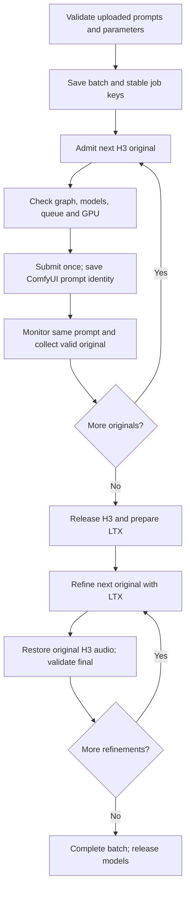

# Latest batch phase / unload audit — 2026-10-25

This section supersedes older per-prompt scheduling and live-state snapshots below.

## File count is not a two-prompt limit

The current exported Markdown is 8,164 bytes and contains only IDs 7 and 8. Its JSON sibling is 32,661 bytes and contains IDs 1–8. Saved batches created from the two-entry manifests also contain only 7/8; an older saved batch contains all eight. No input was edited during this audit.

The textarea/file reader does not truncate at the per-prompt limit. The parser allows 1–100 entries and 1 MB total; the H3 contract allows 6,999 Unicode code points per individual prompt. Invalid input rejects validation, rather than silently keeping the first two. A focused regression parses eight 4,000-character prompts successfully. The two-entry batch was complete after two originals; entering LTX at that point was consistent with that saved manifest.

## What happened at the H3/LTX handoff

Latest failed batch 5fe407d7, prompt 7: H3 ended 05:02:58.597 UTC; LTX started 05:03:04.748. Prompt 8 never received a job. Available host memory rose from 13.3 GiB to about 90 GiB before LTX, and Torch reserved fell to 32 MiB. This supports substantial H3 release, not concurrent H3/LTX execution. It cannot prove eviction of every CPU/dynamic allocation.

NVIDIA reported NV_ERR_NO_MEMORY at 05:05:10 during LTX. Available RAM and swap then became severely constrained. LTX eventually completed and its final was recovered, but the safety pause remained latched. This is an LTX peak-memory incident; neither missing Markdown entries nor the next prompt caused that peak. No promise that 18-second Standard LTX will fit follows from this scheduling fix.

## Changes now implemented

- Restore the owner's latest batch policy: ALL H3 originals, serial execution and validation, retaining H3; confirmed unload; ALL LTX refinements, serial validation with original audio, retaining LTX; confirmed final unload.
- Ledger barrier rejects LTX promotion until every entry has a validated original or an already-completed final. Missing, queued, running, collecting, failed and recovery-required entries block promotion. Refinements follow file order.
- Remove the batch job ID from the worker phase key, so another original/refinement in the same phase does not trigger a model unload.
- Unload admission already failed closed after 30 seconds; it did not blindly load after timeout. Supervised handoffs now continue observing every 10 seconds after that window, requiring two idle low-Torch-allocation observations. Unknown/failed observations cannot authorize a load. Owner cancellation is checked during the wait; claim heartbeat remains active. The shared queue must remain idle. /free acknowledgement alone is never success.
- A deferred/unavailable handoff requeues the unsubmitted take instead of marking its generation failed. Existing prompt identities and recovery prevent duplicate submission.
- Confirm final batch release, and record observed unload seconds in the opt-in timing log. Handoff unload time overlaps the preparation row. ComfyUI execution still includes loading/encoding/denoising/decoding/saving; these measurements do not isolate model loading.

## Verification and limits

17 focused CPU tests passed: phase barrier, ordering/recovery, eight long prompt parsing, delayed release beyond 30 seconds, unknown telemetry, cancellation, model retention, and source dimensions. Frontend TypeScript/Vite build passed. No live generation, batch resume, prompt/media edits, model installs, or clock changes. Owner-clicked generation remains required by AGENTS.md for the live acceptance/timing trial. A simulated 60-second release verified waiting behavior; it is not a measured hardware unload time.

Playwright could not initialize because its Chrome profile was already in use; UI interaction verification remains pending. Runtime reload and code-graph refresh are recorded in HANDOFF.md.

---

## Historical incident evidence (policies/snapshots below may be superseded)

## 2026-10-25 — Small T2V source / completed pause audit (supersedes earlier live snapshot)

- Owner-requested T2V source policy implemented in `backend/story_builder/services/minimax_h3_t2v.py`: final qualities .4/.6/.8/.98/1.5 use the earlier .4 Turbo source budget (576×320 landscape, 320×576 portrait); Max2.0 uses896×512 /512×896. Other ratios keep existing32px-grid fitting. Final preset values/dimensions, supplied prompt, duration, seed, four steps and legacy graphs unchanged. Standard final1344×768 /768×1344. Guided FFLF/R2V unchanged.
- Per-prompt batch sequence remains H3 → idle/release → LTX → validate/register final → idle/release → next. Source policy changes only newly prepared H3 graphs; saved originals and final media are preserved. LTX sets its own exact final canvas independently; no fixed1.5x constraint in the adapter.
- Latest batch5fe407d7 was paused by NV_ERR_NO_MEMORY at05:05:10UTC **during LTX prompt7**, not prompt8 or overlapping H3. H3 finished05:02:58.597; LTX started05:03:04.748. Prompt8 has no job ID. Before LTX, host available memory rose13.3→90GiB and Torch reserved fell to32MiB; during LTX host/swap pressure became severe. Sequential unload worked substantially; LTX has its own memory peak. Smaller H3 is not proof that18s LTX at Standard will fit.
- LTX nevertheless completed05:11:20.366UTC (495.618s /8m15.6); final7.mp4 collected/validated05:11:23.559,18s with audio, asset video_2a11d5011cbce23136d3a1fca7d397d3. Batch safety pause intentionally persisted after recovery; stale fault reason explained simultaneous1complete/error. Owner stopped batch05:19:04UTC. This was one latched incident, not another admission. H3 phase616.599s /10m16.6, source512×896; no simultaneous LTX/H3 execution evidenced.
- Audit checks: all30 quality/AR compiler combinations, preserved prompt/duration and legacy canvas;10 focused CPU tests passed. Updated stale worker test fixtures to include real job IDs and explicit batch membership; added per-stage batch-release check. No GPU submissions, resumes, model/clock changes or media deletion. Code graph refreshed.
- Activated only idle API1423723 / worker1423724 preserving args/env/cwd. Comfy queue empty, no active takes/batches before reload. Logs local_data/logs/t2v-small-source-{api,worker}.log. Current batch remains stopped; owner starts new batch for new source policy. Live render acceptance remains pending. Remaining issue: LTX peak memory at unchanged final size/duration; no guarantee against future OOM.

# T2V batch pipeline audit — 2026-10-25

## New owner-started run: timing and memory evidence

Read-only investigation; no code changes, restart, submission, resume or interrupt.

Batch `5fe407d7-6dbe-48cb-b0ec-235e6822da50`, prompt 7 job `86059961-94a6-44ed-acc6-117b7fc23717`: H3 prompt `ff566639-33e8-58ff-ad2a-3b1b11e3993d` ran 04:52:41.998–05:02:58.597 UTC, 616.599 seconds. Four denoising steps took about 418 seconds; the remaining approximately 199 seconds combines loading, encoding, decoding and saving, not model loading alone. Graph still uses four steps, INT8 ConvRot H3, NVFP4 Qwen encoder and existing Turbo LoRA. Current H3 source is 512×896, 447 frames, requested 18 seconds; final quality .98 is 768×1344 portrait. Earlier .4 quality derives a 320×576 Turbo source under the compiler (2.49 times fewer source pixels); exact old graph is no longer in current Comfy history. The original five-second benchmark is also not directly comparable with 18 seconds.

H3 output was collected 05:03:01 UTC; LTX prompt `fb1e822f-bf58-5083-9e13-e78a8e9ce0e4` was bound 05:03:04.611. Successor prompt 8 has no job ID: it has not been admitted. Memory telemetry shows queue idle and host available memory rising from 13.3 GiB at 05:03:00 to 90.0 GiB at LTX admission, then 92.5 GiB immediately after submission; Torch reservation was only 32 MiB. This is substantial release evidence, though not proof of eviction of every CPU/dynamic allocation.

At 05:05:10 UTC the LTX workload triggered NVIDIA NV_ERR_NO_MEMORY; system available memory had fallen as low as 7.6 GiB and swap free to 0.3 GiB near the fault. Batch controller paused for recovery, while reconciler still observes this same LTX prompt running (latest queue snapshot: one running, zero pending). No H3/LTX execution overlap. LTX logs stage approximately 25.4 GB text encoder and 40.1 GB model weights, in addition to working tensors/other allocations. Peak LTX/unified-memory pressure remains the issue to diagnose; sequential scheduling alone has not solved it. No thermal slowdown was reported in sampled telemetry.

Older batch 2096f3cc: H3 7 19:09:27–19:13:25, H3 8 19:13:26–19:17:01 on Oct 24 UTC; kernel OOM 19:13:31 during H3 8. LTX 7 started only 19:27:18 and was later interrupted by telemetry timeout. The saved manifest had only two entries (7/8); starting LTX after those two was after that batch's originals, not before completion. Previous .98 batch 0c57e725 also had no LTX submitted when its H3 monitor timed out. These are distinct failures, not one proven overlap defect.

## Latest incident and superseding batch policy

Latest batch `0c57e725-7a9c-40a1-a71e-66c2576e11e7` contains only prompt IDs 7 and 8. It paused at 04:13:21 UTC because the independent GPU admission/monitor query timed out after two seconds (`gpu_limit_monitor_failed` / `nvidia-smi`). ComfyUI subsequently completed prompt 8 at 04:23:41 UTC; both H3 originals are saved and validated, 512×896, 447 frames at 24fps, with audio. Neither LTX stage had started. No matching NVIDIA/OOM kernel entry was found in the latest incident window; the older OOM incident below is distinct.

Owner-requested standalone batch sequence now completes **H3 → unload → LTX → final validation/audio preservation → unload** for each prompt before admitting its successor. Ledger refinement promotion follows file order; the worker enforces an idle queue and allocator-release observation on stage/prompt handoffs. Existing two saved originals can be refined in order after owner Resume, without regenerating them. Automated story staging is unchanged.

Worker monitoring now reuses a fresh independent watchdog sample instead of launching a second competing GPU probe every poll. Missing/stale/failed telemetry still blocks progress. Recovery payloads now persist into the job error field, allowing the actual reason to reach batch status instead of only the event log. No temperature/clock safeguards were relaxed. Model release reduces residency pressure; it cannot guarantee that any long render will fit memory or that telemetry will never fail.

Checks: Python AST syntax and frontend production build passed. Code graph refreshed. Playwright interaction check was blocked by its existing browser profile lock. No GPU generation was started or resumed. The following original audit describes older batches and is historical where its sequence conflicts with this section.

## Earlier outcome

Audited the complete standalone batch path: upload/validation → durable admission → ComfyUI execution → collection → next prompt → LTX refinement → named final output, including pause/stop/restart/recovery. Fixed connection recovery, recovery-path model retention and misleading pending spinners. No prompts, workflows, screenplay or media were changed. No GPU job was submitted or resumed during this audit.

The current batch is **paused, not rendering**. ComfyUI has zero running and zero pending jobs. Prompt 7's final exists; prompt 8's H3 original exists and awaits LTX. This pause followed an actual NVIDIA out-of-memory diagnostic, so it was deliberately preserved. This is not evidence that prompt 8's original needs regeneration.

## How one batch runs

1. **Validate:** Markdown/text/JSON is parsed; file size, prompt length, duration, aspect ratio and quality are checked. Safe IDs are unique case-insensitively within the file. Nonconsecutive numeric IDs and names are supported. Execution follows file order. Filename collisions use the existing overwrite/new-take decision.
2. **Persist:** The batch manifest, parameters, filename reservations and admission keys are stored in SQLite. A stable key binds each entry to its saved job. A lost HTTP response or restart does not authorize a duplicate render.
3. **Admit:** The existing worker supervisor advances the batch. A file lock serializes admission/control changes. Only one outstanding job progresses at a time. The browser displays/polls state; refreshing the page or batch status does not drive generation or submit another job.
4. **Execute H3:** The existing durable worker checks workflow hashes, nodes/models, queue ownership and GPU readiness. It reserves a ComfyUI prompt identity before submission, posts the graph, then monitors that same identity. H3 receives the supplied prompt; batch generation attaches no references. The Turbo graph uses four steps.
5. **Collect original:** ComfyUI execution success alone is insufficient. Collection validates the output and saves the original in `local_data/t2v_originals/<workspace>/<job>/<hash>.mp4`. The job becomes `refinement_pending`. Only then may the next H3 original start.
6. **Switch stages:** All originals are produced first. H3 is retained between originals. At the H3 → LTX transition, H3 is unloaded and the LTX input is staged under ComfyUI's `input/vibe_t2v/<job>/ltx_input.mkv`.
7. **Refine:** Three-step LTX/Sol refinement runs serially. It uses the original prompt plus the owner-approved preservation instruction, without an LLM rewrite. LTX is retained while further eligible refinements are ready. Models are released after the final ready refinement.
8. **Finish:** Original H3 audio is restored to the refined video. Final canvas/frame count/duration/audio and file integrity are checked. The named asset is registered under `local_data/assets/<workspace>/<prompt-ID>.mp4` (or its allocated take suffix). A valid `needs_review`/accepted video counts as batch completion; batch advancement does not require clicking Accept.

ComfyUI writes intermediate outputs to its own output directory as configured by the graphs. The project original store, ComfyUI intermediates and named final asset have different purposes; they are not all final copies.

## Incident reconstruction

All timestamps below are **UTC, 2026-10-24**; add 5h30 for local India time.

| Time | Evidence / transition |
|---|---|
| 12:03:21 | Prompt 7 H3 submitted, ComfyUI `10a3b23b-1fc9-5a8a-9c53-6e7ff0edb4e3`. |
| 12:07:08 | Prompt 7 original collected; prompt 8 H3 submitted as `5f787fd1-9263-59fa-83ce-74f7855c4f47`. |
| 12:07:37 | Runtime `/system_stats` request timed out. Worker marked recovery required; old controller paused batch. |
| 12:07:38 | Worker reconciled the same prompt as running. No new render was submitted. |
| 12:10:37 | Prompt 8 original collected successfully. Old batch state nevertheless remained paused. |
| 18:16:21 | After later resumption, prompt 7 LTX submitted as `d9f1ce50-4269-579e-8cb6-13cce0a47f95`. |
| 18:17:13 | GPU monitor detected `NVRM ... Out of memory [NV_ERR_NO_MEMORY] ... _memdescAllocInternal ... mem_desc.c:1359`. Batch paused again. |
| 18:20:06 | Prompt 7 LTX output collected and final registered. Batch remained paused; prompt 8 LTX did not start. |

There were **two different causes**, not two identical hangs. The first was a connection timeout; the second was a real NVIDIA driver memory error. A finished render does not erase the memory diagnostic. The exact allocation pressure/root cause is not established by this audit. An 18-second workload is not comparable to the earlier five-second benchmark; attributing all delay to loading would be unsupported.

### Current saved identities

- Workspace: `media-49e2cabe-4ff4-416c-9b5d-edc7c758b0df`
- Batch: `35faf6db-ebf8-4184-a9f4-23a4c2fd6ccb`, paused, 1/2 complete.
- Prompt 7 job: `545bf472-4c90-4a81-8685-5d2ef51e5241`, final available, `needs_review`.
- Prompt 8 job: `48f0df95-6928-4a08-9d5a-1106e2dfda9a`, original ready, `refinement_pending`.
- Final 7: `local_data/assets/media-49e2cabe-4ff4-416c-9b5d-edc7c758b0df/7.mp4`; 18.016 seconds, 480×864, 24 fps, stereo AAC.
- Final 7 SHA256: `4c6efce2d9199c552fe91b5ae4a36b3a20160f0d4f735e4673f4110a99d657cb`.

The existing paused reason is historical generic text. New pauses include the actual worker error. Existing stopped batches were not altered.

## Defects fixed

| Finding | Change |
|---|---|
| A single ComfyUI runtime timeout immediately interrupted monitoring. | Transport-only runtime errors now have a distinct type. The worker tolerates two consecutive failures, retrying the runtime sample; independent watchdog and operating-point checks continue. A third failure enters recovery for the same saved prompt. HTTP/invalid-runtime errors and actual GPU faults retain their stricter handling. |
| A recovered job could finish while its batch remained permanently paused after a transport fault. | New transport-only recovery uses `waiting_for_recovery`. The supervisor reconciles that same job and continues when confirmed. It does not blindly resubmit. Explicit user pauses and GPU/safety/failure pauses remain paused. |
| Successful recovery always released models, even between originals/refinements. | Normal completion and recovered completion now share the same stage-aware release decision. |
| Pending LTX entries displayed a spinning indicator even when no work was executing. | Batch pending/recovery states use static status text; execution states still animate. “Waiting for LTX video refinement” remains the label. |
| Error pauses hid the useful underlying cause. | New pause reasons include the saved error message. |

Changed code: `gpu_runtime.py`, `production_job_worker.py`, `t2v_batches.py`, `T2VBatchPanel.tsx`. Added CPU regression checks in `test_t2v_batch_recovery.py`.

## Controls and failure routing

| Situation/action | Result |
|---|---|
| Refresh batch status / reload | Read saved progress; no new generation. |
| Pause | Current submitted work may finish; block the next admission/refinement. |
| Resume | Recheck saved state and continue eligible work. Does not regenerate failed jobs or duplicate originals. |
| Stop | Prevent later prompts; cancel owned queued work and request interruption of owned active work. |
| Brief runtime connection loss | Retry monitoring while safeguards remain active. |
| Sustained transport-only loss | Wait for recovery of the same prompt identity. |
| GPU fault, missing/invalid output, unknown submission or failed job | Block progression. No blind resubmission. |
| Completed render without usable video | Not counted as complete. |
| User pause or safety pause followed by job success | Remain paused until explicit user action. |

For this batch, after addressing/checking the GPU memory condition, **Resume batch** should skip prompt 7's existing final and continue prompt 8's LTX refinement from its saved original. This live GPU continuation remains owner-clicked; it was not performed for this audit.

## Evidence and limits

- 35 CPU tests passed: eight new batch/worker recovery checks plus 27 runtime/workload-policy checks. Includes no-duplicate submission, transient versus GPU error, manual pause persistence, missing output and model retention.
- Frontend TypeScript/Vite build passed (existing large-chunk warning).
- Changed Python modules parsed successfully. Graphify refreshed; its limited backend indexing was supplemented by direct source tracing.
- Playwright MCP could not initialize because its browser profile was already in use: `Browser is already in use for /home/riki/.cache/ms-playwright-mcp/mcp-chrome-c9ae093, use --isolated ...`.
- CUA fallback opened the idle Current Take page and confirmed paused 1/2, Resume/Stop controls and static pending LTX text. No generation controls clicked.
- Reloaded idle API/worker preserving their existing environment: API PID **296398**, worker PID **296399**. Post-reload batch remained paused; ComfyUI queue was 0 running / 0 pending. Logs remain `local_data/logs/batch-output-names-{api,worker}.log`.
- No provider/GPU generation or new media deletion. Tests/build are not proof of visual quality, future render speed or resolution of the NVIDIA memory condition.
- Documentation discrepancy: AGENTS mentions 83°C, while the inspected current runtime source uses 90°C and a 2100 MHz ceiling. This audit changed neither thresholds nor clocks; reconcile that policy separately before treating the older prose as current enforcement.

## Authoritative implementation map

- `frontend/src/T2VBatchPanel.tsx`: upload/validate/start/status/control UI.
- `frontend/src/lib/video-api.ts`, `backend/story_builder/isolated_server.py`: API seam.
- `backend/story_builder/services/t2v_batches.py`: manifest, admission, progression and controls.
- `backend/story_builder/services/production_ledger.py`: durable jobs, stage eligibility and identity.
- `backend/story_builder/isolated_worker.py`: existing supervisor.
- `backend/story_builder/services/production_job_worker.py`: submission, monitoring and recovery.
- `backend/story_builder/services/isolated_video_jobs.py`, `t2v_pipeline.py`: staging, graph binding, collection, original/final validation and audio remux.
- `backend/story_builder/services/gpu_runtime.py`, `gpu_watchdog.py`: runtime and independent safeguards.

## Follow-up: second H3 allocation error and LTX telemetry interruption

New batch `2096f3cc-78c7-4ae5-8729-919b5f4c27e4` is paused. The earlier batch described above is now stopped; its registered `7.mp4` is not a final for this new batch.

UTC 2026-10-24 evidence from Comfy history, timestamped container logs and kernel journal:

- Prompt 7 H3 (`c892eb31-087a-504f-9868-e45490e221ec`) ran 19:09:27–19:13:25.
- Prompt 8 H3 (`bbe6c98d-f9bc-505a-86fb-f5788f5cf38a`) submitted 19:13:26; NVIDIA logged NV_ERR_NO_MEMORY at 19:13:31; monitor detected it shortly afterward. H3 nevertheless finished at 19:17:01. The selected logs contain no Python CUDA OOM exception.
- Prompt 7 LTX (`3ba864ab-753b-53e3-ade7-1a67a9da7f6e`) started 19:27:18, ten minutes after H3 completed. A two-second nvidia-smi timeout at 19:28:06 caused interruption at 19:28:07 and recovery_required. Prompt 8 LTX never started.
- No H3/LTX execution overlap. The allocation error coincided with preparing the second H3 model; it is not evidence of LTX starting early. Retained allocations, unified-memory pressure and driver allocation behavior remain hypotheses.
- Both originals are 320×576, 24fps, 447 padded frames (18.625 seconds) for requested 18 seconds. An 18-second workload has about 3.6 times the frames of a five-second workload; peak memory is not determined by duration alone and need not scale linearly.
- Idle snapshot: GB10, Comfy 0.31.0, Torch 2.11.0+cu130, cudaMallocAsync; ~90GiB host available, ~11GiB swap occupied, Torch ~32MiB reserved. An idle snapshot does not establish memory available at the failed allocation.

### Bounded follow-up changes

- Operating-point reads retry exactly once only for subprocess timeout (two seconds per attempt); malformed data, command failures, temperatures/clocks and driver faults are not relaxed. Persistent missing telemetry still stops the run. The bounded read fits inside the independent watchdog's six-second freshness budget.
- Added host-memory and Torch allocator context to runtime samples, and a diagnostic record at detected NVIDIA driver faults. Journal write failure cannot mask the fault.
- Pipeline entry and H3↔LTX stage switches now request unload and wait up to 30 seconds for two idle queue/low Torch-allocation observations. Budgets: reserved ≤256MiB, active ≤64MiB. These are observable idle allocator budgets, not a minimum-free-VRAM admission rule or proof all dynamic/CPU weights were evicted. ComfyUI /free only sets asynchronous worker flags; no completion/residency endpoint exists in this installed server. Failed/missing observations block preparation. Successful observations are appended to the existing GPU telemetry journal with phase pipeline_memory_handoff (and logged at INFO when enabled).
- Keep models between same-stage batch clips. Keep all originals first, then all refinements. Switching models for every prompt adds loading and has no demonstrated fix for the second-H3 allocation failure. No duration, prompt, resolution, workflow sampling settings, thresholds or clocks changed.

Evidence: changed Python files parse successfully; Graphify refreshed. No automated tests or live GPU generation started. Root memory cause and live effectiveness remain unconfirmed until owner continuation; no claim that 18-second OOM is cured.
